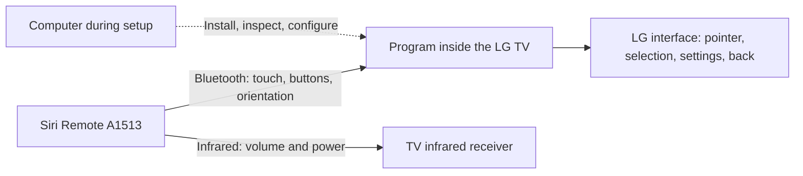
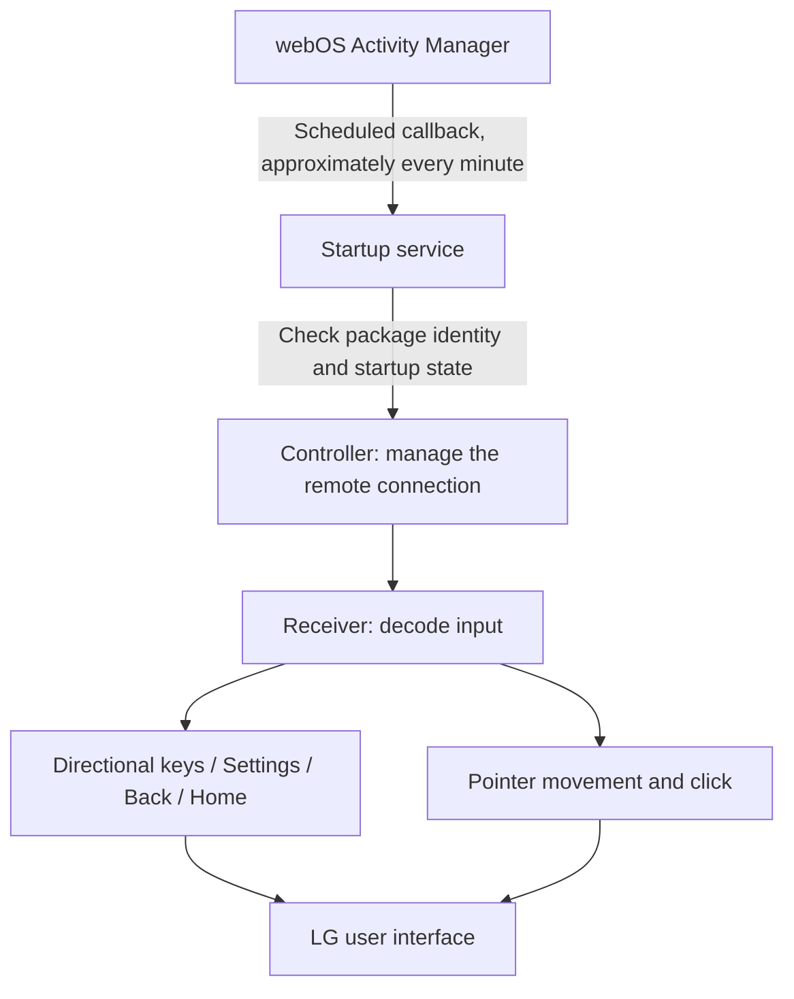
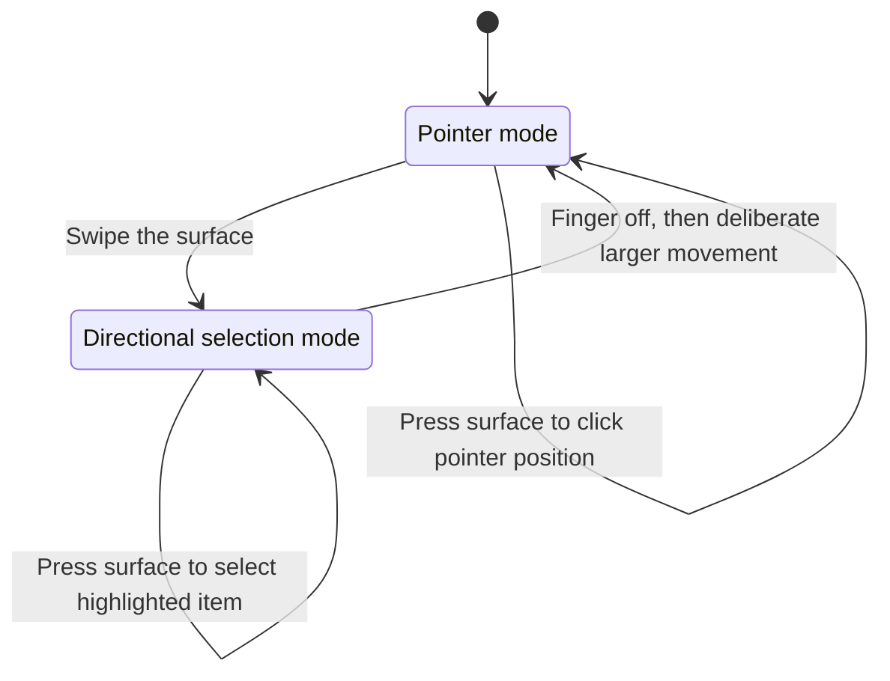
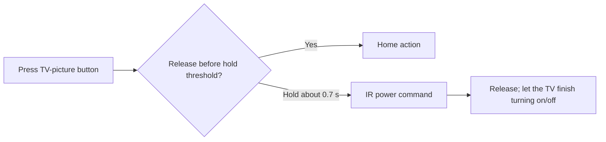
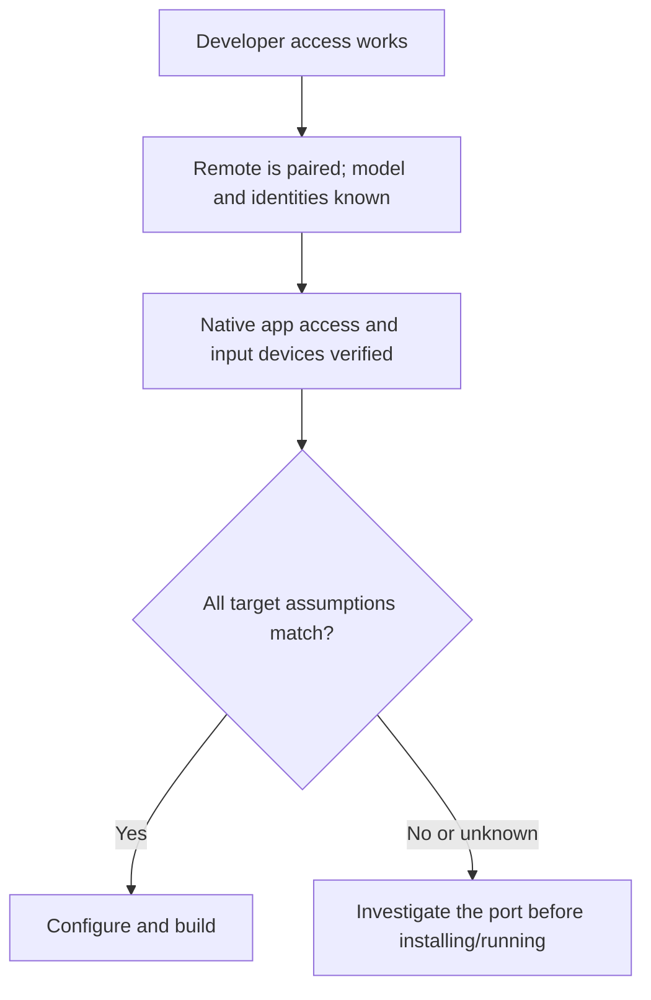
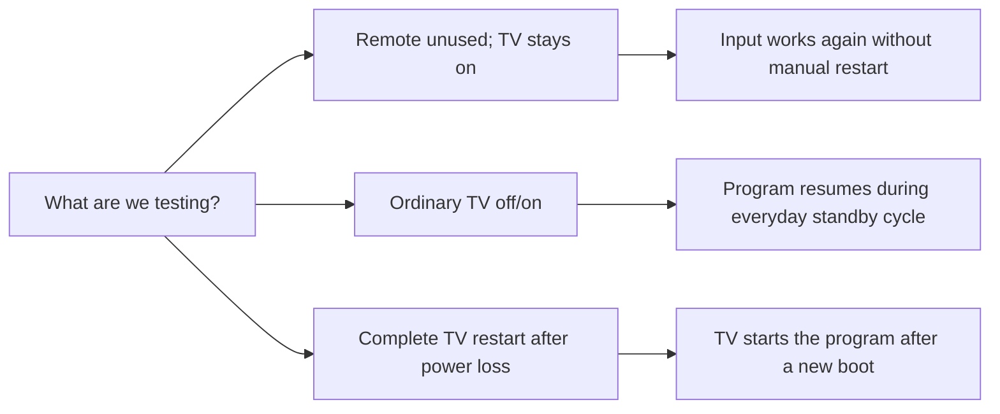
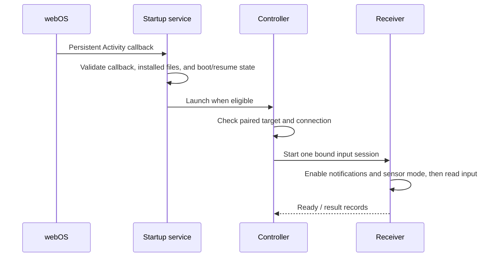
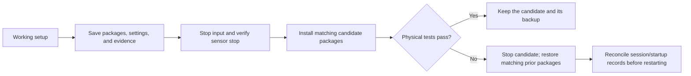

# Magic Sirimote

Thank you to the open-source Siri Remote and LG webOS communities—especially [open-appleremote](https://github.com/a-funk/open-appleremote), [SiriRemote-Linux](https://github.com/Yanndroid/SiriRemote-Linux), [Clean Your TV](https://github.com/Razdva122/clean-your-tv-lg-webos), and [webOSbrew](https://www.webosbrew.org/)—for sharing the tools, code, and discoveries that made this project possible.

**Use a first-generation Siri Remote to control an LG TV, with the input program running inside the TV.** Swipe to select an app, move the remote to move the pointer, press to select, open settings, go back, and control volume and power over infrared. No Mac, Apple TV, or other computer needs to stay on for everyday use.

This repository shares a working, owner-tested implementation and the lessons behind it. Development combined hands-on testing by the owner with implementation and investigation assisted by OpenAI Codex.

> **Read this before installing:** this is an experimental reference release for a tested **A1513 Siri Remote + LG G3** setup. The demo, tests, and package builder can run now. A fresh installation on somebody else's TV still requires device-specific pairing, identity, permission, and startup checks. There is **no universal one-click installer**, and rebuilding the published source is not the same as validating it on your TV. The guide below marks that boundary explicitly.

## Contents

- [What works](#what-works)
- [How the pieces fit together](#how-the-pieces-fit-together)
- [Using the remote](#using-the-remote)
- [Before you begin](#before-you-begin)
- [Step 1: Try it without touching your TV](#step-1-try-it-without-touching-your-tv)
- [Step 2: Set up developer access](#step-2-set-up-developer-access)
- [Step 3: Identify and check your devices](#step-3-identify-and-check-your-devices)
- [Step 4: Build packages for your setup](#step-4-build-packages-for-your-setup)
- [Step 5: Install and start on a verified setup](#step-5-install-and-start-on-a-verified-setup)
- [Step 6: Set up infrared separately](#step-6-set-up-infrared-separately)
- [Step 7: Verify everyday use](#step-7-verify-everyday-use)
- [Automatic startup and Developer Mode](#automatic-startup-and-developer-mode)
- [Troubleshooting](#troubleshooting)
- [Backup, updates, and removal](#backup-updates-and-removal)
- [Source code and contributing](#source-code-and-contributing)
- [Credits and license](#credits-and-license)

## What works

The following behavior was physically confirmed by the owner during development, ending on **November 2, 2026**.

| Action | Result | Path |
| --- | --- | --- |
| Swipe the touch surface | Move the highlighted selection up, down, left, or right; hide the pointer | Bluetooth → TV program |
| Press the surface while a selection is highlighted | Select/open the highlighted item | Bluetooth → native Enter key |
| Move the remote deliberately, with your finger off the surface | Show and move the pointer | Bluetooth → TV program |
| Press the surface in pointer mode | Click at the pointer position | Bluetooth → mouse click |
| Short-press MENU | Open LG settings | Bluetooth → native Settings key |
| Short-press the microphone button | Go back | Bluetooth → native Back key |
| Short-press the TV-picture button | Go to LG Home | Bluetooth Home action; an IR Home entry also exists in the tested remote |
| Hold the TV-picture button for about **0.7 seconds**, then release | Toggle TV power | Infrared from the remote |
| Volume + / − | Adjust TV volume | Infrared from the remote |
| Play/Pause | Pause/resume video in the tested app | Bluetooth; chooses Play or Pause from current media state |

The two recent remaps are intentional: **MENU means Settings**, and **the microphone button means Back**. Voice input is not implemented.

### Compatibility and limits

| Item | Tested baseline / current limit |
| --- | --- |
| Remote | Black first-generation **A1513**; Main firmware 0241, Radio 0107 |
| TV | **LG OLED55G3PJA**, firmware **43.21.96** |
| Input apps | Controller and receiver 0.9.71 |
| Startup package | 0.0.64 |
| Regular TV off/on | Confirmed on the working installation |
| Full loss of power and restart | Confirmed on the working installation before the final button remap; startup logic was preserved |
| Leaving the remote unused, then using it again | Owner reported normal operation; actual remote sleep/disconnection was not independently established in the final test |
| Pointer motion while touching the surface | **Not supported in this accepted version**; remove your finger to move the pointer |
| A1962, later silver remotes, other LG models/firmware | Not validated by this project |
| Long-term Developer Mode renewal | One extension experiment succeeded; indefinite unattended operation is not established |
| Public parameterized build | Builds and passes host tests; has not replaced the working installation on the owner's TV |

This reproduces many everyday Magic Remote interactions, not every function of LG's original remote. Keep the original remote available for setup and recovery.

## How the pieces fit together

There are two independent routes from the remote to the TV:



The computer is a setup tool. It is not a relay for normal button presses. Infrared also works independently of the TV input program once the remote has the correct IR configuration.

Inside the TV, three packages divide the work:



The minute-based callback is for startup and recovery decisions. It does **not** mean the remote's input is processed once a minute. The receiver handles input continuously while running.

## Using the remote

### Two ways to select things

Think of the touch surface as a small directional pad, and the whole remote as an air pointer.



1. **To navigate by selection:** swipe. The pointer disappears. Swipe again to move the highlight, then press the surface to open the selected item.
2. **To use the pointer:** lift your finger off the surface and make a deliberate movement with the remote. Once the pointer appears, smaller movements move it. Press the surface to click.
3. **After a fresh connection:** place the remote on a flat surface, with nothing touching the touch area, for about five seconds. This gives the orientation calibration time to settle.

Small hand movements after a swipe should not immediately bring the pointer back. This was an important part of making the remote behave naturally.

### Power is a short hold, not a three-second wait



The tested remote's threshold is approximately **0.716 seconds**, not a guaranteed wall-clock response time for the TV screen. Hold for a little under a second and release. Do not keep holding until the entire startup animation finishes. A power toggle is not a separate “on” or “off” command.

## Before you begin

You need:

- An A1513 Siri Remote and a charged battery.
- A compatible LG webOS TV. Only the G3 configuration above has been validated here.
- The original LG remote.
- A computer for preparation, on the same network as the TV.
- A macOS or Linux development environment, Python 3.9+, Node.js 18+, and Git. The exported workflow was tested on macOS; Linux/WSL host setup has not been independently verified.
- Clang with an ARM target to build the small native launchers. The builder defaults to `clang`; set `CLANG` if yours is elsewhere.
- Developer access to your own TV and an understanding of the [porting checkpoints](docs/PORTING.md).

The source targets a **32-bit ARM Linux input layout** and uses Python, Node, and webOS libraries already present on the tested TV. Having a newer or more expensive LG TV is not sufficient to establish compatibility.

A normal charging cable is not the special diagnostic cable used during investigation. Daily operation needs neither cable. The public release does not contain a general-purpose diagnostic-cable programmer.

## Step 1: Try it without touching your TV

Download or clone this repository and open a terminal in its directory. All commands in this section run on your computer.

```sh
python3 src/demo.py
```

Expected output includes:

```text
MENU
  TV action: settings
Microphone
  TV action: back
TV
  TV action: home
Play/Pause
  TV action: playpause
```

This uses the actual button decoder with made-up input packets. It does not connect to Bluetooth, change a TV, or transmit infrared. A held button generates one action, not a stream of repeated clicks.

Run the host tests:

```sh
python3 src/check.py
```

The tests cover swipe/click behavior, pointer/selection transitions, key release, input-device validation, and the startup service's bookkeeping. They simulate device operations; passing them is **not** a hardware compatibility result.

You can also build an example without entering any personal device information:

```sh
python3 src/build.py --config config.example.json --out build/example --example
```

This produces three `.ipk` packages, a manifest, and `SHA256SUMS`. **Do not install the example packages.** Their Bluetooth identities are deliberate placeholders.

## Step 2: Set up developer access

LG's official [Developer Mode guide](https://webostv.developer.lge.com/develop/getting-started/developer-mode-app) describes the account, TV app, and network connection requirements. Its [CLI guide](https://webostv.developer.lge.com/develop/tools/cli-dev-guide) describes the commands used below. Follow those guides for your current tools and TV.

In outline:

1. Install the **Developer Mode** app on the TV.
2. Sign in with your LG developer account and enable Developer Mode. Complete the requested reboot.
3. Enable its key server when obtaining the development connection key.
4. Add your TV using the webOS CLI or [webOS Dev Manager](https://github.com/webosbrew/dev-manager-desktop).
5. Confirm that you can list installed apps using your own device alias. The examples below use `my-tv`.

```sh
ares-setup-device --list
ares-install --device my-tv --list
```

Credentials stay in your local developer tooling. Do not put your LG password, SSH key, session token, or connection configuration in this repository.

**Developer Mode access is only the first step.** It does not guarantee that an installed native app can read the remote or write the TV's input devices. The working receiver ran under ordinary application accounts, but that observation is not a promise of root-free installation on every model or firmware. This repository does not install a root exploit or modify firmware.

## Step 3: Identify and check your devices

**This is the first device-specific checkpoint.** If you cannot establish these facts, stop here and use the source as a reference while investigating your model.

The working setup already had the remote paired with the TV. This release does not automate first-time pairing. Pairing instructions for an Apple TV do not by themselves establish that the remote is paired with an LG TV.

Record the following locally:

| Fact | Why it matters |
| --- | --- |
| Remote model and firmware | Different generations can send different data |
| Remote Bluetooth address | Prevents controlling an unintended nearby device |
| TV Bluetooth adapter address | Confirms the connection belongs to the expected TV |
| Exact remote name/serial exposed by Bluetooth | Additional identity check |
| Developer, controller, and receiver numeric user IDs | The runtime checks file/process ownership; these are not passwords |
| `LGE RCU` and `ClickableMouse` input devices | These provide the tested key and pointer output paths |
| A readable matching `hidraw` device and the expected report layout | This provides the remote's input stream |
| Native app access to the relevant webOS services | SSH access and app permissions are different things |

See [PORTING.md](docs/PORTING.md) for the precise interfaces, ownership assumptions, and the clean-install gap. In particular, application user IDs may only be available after installing an inert package for inspection. Do not launch the receiver with guessed IDs, or change broad system permissions to make a failed check disappear.



## Step 4: Build packages for your setup

Copy the example configuration:

```sh
cp config.example.json config.local.json
```

Edit `config.local.json` with the values you actually measured:

| Field | Meaning |
| --- | --- |
| `remoteAddress` | Siri Remote Bluetooth address, lowercase colon-separated hex |
| `adapterAddress` | TV Bluetooth adapter address in the same format |
| `remoteName` | Exact observed remote name/serial; the current configuration validator accepts ASCII letters, digits, `_` and `-` |
| `developerUid` | Numeric account ID for the developer connection |
| `controllerUid` | Numeric account ID assigned to the controller app |
| `receiverUid` | Numeric account ID assigned to the receiver app |
| `devmodeMaintenance` | `disabled`, `check-only`, or `extend`; explained below |

The numeric IDs in the example are **historical baseline values**, not defaults that are safe to assume on your TV. The builder checks their format, not their correctness on a real device. Other fixed platform assumptions remain; this file is not a universal compatibility switch.

Build using your local configuration:

```sh
python3 src/build.py --config config.local.json --out build/my-tv
```

Choose a new output directory for each build. The builder refuses to overwrite an existing one. For a non-example build it also refuses unchanged placeholder device identities.

The output contains:

| Package | Role |
| --- | --- |
| `org.codex.siriremote.autocoord20261029v_0.9.71_arm.ipk` | Connection controller |
| `org.codex.siriremote.hidgattrouterb20261029u_0.9.71_arm.ipk` | Input receiver |
| `org.codex.siriremote.v20scheduler20261031a_0.0.64_arm.ipk` | Startup app and service |

The long internal package names are retained for compatibility with the tested implementation. Do not rename just one package: the components verify one another's identities and file hashes.

The builder regenerates those hashes from the configured source. This is why editing a file inside an installed package afterward can cause startup to be refused.

## Step 5: Install and start on a verified setup

**This is an advanced, conditional stage, not an unattended installer.** Continue only after the checks in Step 3 and [PORTING.md](docs/PORTING.md) are satisfied. A clean-TV installation has not been independently reproduced from this public checkout.

Before updating an existing installation, stop its input session cooperatively and verify the receiver's sensor-stop result. Keep its packages and state records. Do not overwrite a running receiver or delete its state to get past a refusal.

On a prepared, verified TV, the package installation commands are:

```sh
ares-install --device my-tv build/my-tv/org.codex.siriremote.autocoord20261029v_0.9.71_arm.ipk
ares-install --device my-tv build/my-tv/org.codex.siriremote.hidgattrouterb20261029u_0.9.71_arm.ipk
ares-install --device my-tv build/my-tv/org.codex.siriremote.v20scheduler20261031a_0.0.64_arm.ipk
```

Then:

1. Compare the installed files with `build/my-tv/manifest.json`, including package metadata and the startup service. Re-check app user IDs and state-directory ownership after installation.
2. Put the TV on its home screen. Disconnect the remote's diagnostic cable, if one is attached.
3. Press the touch surface to wake the remote.
4. Launch the **controller**, not the receiver directly:

   ```sh
   ares-launch --device my-tv org.codex.siriremote.autocoord20261029v
   ```

5. Look for a new `receiver-ready-<run>.json` in the receiver's `state` directory. A launch acknowledgement alone only proves the launch request was accepted.
6. Stop pressing the surface. Place the remote still for about five seconds, then perform the checks in Step 7.

The controller obtains the receiver's current file hashes from the startup service. Installing that service is therefore required even for manual controller launch. **Installing it does not automatically register startup.** Startup provisioning is a separate operation described in [PORTING.md](docs/PORTING.md#startup-provisioning).

## Step 6: Set up infrared separately

The program that handles Bluetooth input does not, by itself, teach the remote infrared commands. The working remote had its IR entries read, preserved, and selectively restored/configured during development.

The tested IR configuration was:

| Remote button | Entry | LG NEC bytes |
| --- | --- | --- |
| Volume + | Immediate | `20 DF 40 BF` |
| Volume − | Immediate | `20 DF C0 3F` |
| TV-picture | Immediate Home | `20 DF 3E C1` |
| TV-picture | Delayed Power, firmware delay selector `2` | `20 DF 10 EF` |

These bytes describe the tested remote's stored configuration. They are **not** ready-to-send shell commands. The delay selector is not a number of seconds; selector `2` produced the approximately 0.716-second behavior on this firmware.

A Bluetooth Home event and the stored IR Home entry can coexist. This release does not claim hardware-level short/long-press suppression across both routes; holding the TV button may produce Home before Power. The table describes the owner-accepted behavior, not a guarantee that a long press emits only Power.

If your remote already controls volume and power correctly, preserve those settings. If it does not, read [IR.md](docs/IR.md) before adapting an IR programmer. The repository includes a pure packet encoder for inspection, **not** a universal IR-writing tool:

```sh
python3 src/ir_packets.py
```

Confirm IR independently with the TV input program cleanly stopped: point the remote at the TV, press Volume + once and Volume − once, and check that the volume rises and returns. Test power separately. Do not infer IR success from a Bluetooth-delivered key.

## Step 7: Verify everyday use

Run these tests in order. If one fails, record exactly which step failed before changing anything.

| Test | What to do | Success looks like |
| --- | --- | --- |
| Directional selection | Swipe on the home screen | Pointer disappears; highlight moves |
| Selection click | Press after choosing an app by swiping | Highlighted app opens |
| Back | Short-press microphone | Previous screen returns |
| Settings | Short-press MENU | LG settings opens |
| Home | Short-press TV-picture | LG Home appears |
| Pointer | Finger off, five seconds still, then deliberate movement | Pointer appears and follows movement |
| Pointer click | Point at an item and press surface | Item under pointer is clicked |
| Media | Play a video; press Play/Pause twice | Pause, then resume in a supported media state |
| Volume | Point at TV; + once, then − once | Volume rises, then returns |
| Power | Hold TV-picture briefly, release; wait; repeat | TV switches off and back on |

For persistence, distinguish three different tests:



- **Remote left unused:** leave the TV on and the unplugged remote untouched for about 15 minutes, then press the surface and try the controls. Note any delay. This proves usability after inactivity; proving actual remote sleep needs connection evidence as well.
- **Ordinary off/on:** after configuring startup, turn the TV off normally, wait about 30 seconds, and turn it back on. Try the same controls without using the computer to relaunch anything.
- **Full restart:** this is a separate startup test, not a daily requirement. When the TV is not updating, turn it off, disconnect its own power plug for about 30 seconds, reconnect, and start it again. Do not switch a household breaker for this test. Check automatic startup and input without a manual launch.

A working pointer is not proof that all buttons work. A successful power toggle is not proof that Bluetooth input resumed. Test both paths.

## Automatic startup and Developer Mode

“TV-local” means the program can run inside the TV. It does **not** mean it is permanently written into LG's firmware.



The implementation uses a persistent webOS **Activity**, roughly a recurring system callback. This is an internal startup mechanism, not a viewing/recording timer you must set in the TV guide. It keeps records so that a delayed callback or uncertain launch does not blindly start another input process.

Developer Mode still has an expiry. LG documents that expiry can disable Developer Mode and remove development apps. Follow [LG's current guidance](https://webostv.developer.lge.com/develop/getting-started/developer-mode-app); do not treat this repository as an expiry bypass.

Public builds default to **`devmodeMaintenance: "disabled"`**:

| Setting | Behavior |
| --- | --- |
| `disabled` | No session-token read or LG session query by the maintenance module; manage expiry yourself |
| `check-only` | Read the TV's existing Developer Mode session token locally and query LG's official server; do not extend |
| `extend` | Also attempt official app-based extension when at most 14 days remain, normally checking daily |

The query uses HTTPS to `developer.lge.com`. The extension route launches LG's Developer Mode app with an extension request; its UI may appear. The source avoids printing or storing the raw token. An uncertain extension is retained as uncertain rather than immediately retried. These are implementation details of the experiment, not a documented guarantee from LG.

Changing `devmodeMaintenance` requires rebuilding and updating the package. The published default differs from the owner's existing experiment; exporting this repository did not change the running TV.

## Troubleshooting

| Symptom | Check first |
| --- | --- |
| Volume works, but swipes do nothing | IR and Bluetooth are separate. Check controller/receiver readiness and the paired target |
| Pointer stops when my finger touches the surface | Expected in this version; lift your finger |
| Pointer does not appear after a swipe | Finger off; deliberate larger movement. Small hand tremors deliberately keep selection mode |
| Pointer never starts after connection | Place the remote still with no surface contact for about five seconds; inspect calibration/readiness |
| Click works with the pointer but not after swiping | Confirm the matching receiver build; selection mode must emit Enter, not a mouse click |
| Settings works but microphone does not go back | Confirm the final button mapping and supported packet shape; no voice processing is needed |
| Play/Pause does nothing in one app | Media state may be missing or stale; the implementation does not blindly guess a toggle |
| Power seems slower than 0.7 seconds | Release after the threshold; screen startup time is separate from button hold time |
| `ares-launch` succeeds but there is no response | Check the per-run ready/result records; a launch acknowledgement is not receiver readiness |
| A package hash/ownership check fails | Verify the installed build and target account IDs. Do not disable checks or recursively chmod system directories |
| It works until an ordinary TV off/on | Inspect startup binding, power-state evidence, and retained stop requests |
| Diagnostics stop updating after a couple of minutes | Startup progress snapshots are intentionally bounded; a stale snapshot alone does not prove a stopped receiver |
| Bluetooth reports an error or stops replying | Preserve the result and session records. Do not repeatedly restart Bluetooth, re-pair, or resend sensor commands without understanding the current state |

The runtime favors stopping on an uncertain state over repeatedly issuing device commands. A retained record may be the reason it refuses to start, but it may also be the evidence needed to stop a previous sensor session correctly.

## Backup, updates, and removal

Before changing a working setup, keep:

- The exact three packages and their `SHA256SUMS`.
- Your local configuration, stored privately.
- A private copy of the relevant runtime/startup records, with ownership information.
- A readback of the remote's IR entries before changing them.
- A short list of physical tests that passed.



A backup of application packages is not a full TV-firmware or remote-EEPROM backup. Do not restore old runtime state over a live session, and do not copy another TV's private state.

For removal, first disable/cancel the exact startup Activity through its creator, then request a cooperative controller stop and verify the receiver reports `sensorStopVerified: true`. Preserve any uncertain result for diagnosis. After no related process remains, remove the three app packages with your developer tooling. The IR settings live in the remote and survive removal of the TV apps; restore them separately if desired. See the [lifecycle notes](docs/PORTING.md#stopping-updating-and-removing).

## Source code and contributing

```text
src/
  demo.py               # Synthetic buttons; no hardware access
  check.py              # Host-only test runner
  build.py              # Configured three-package builder; no TV contact
  build_support.py      # Deterministic IPK archives and tiny ARM launchers
  ir_packets.py         # Pure IR configuration packet encoder; never transmits
  runtime/              # Controller, receiver, decoding, output, lifecycle
  scheduler/            # Startup/standby/expiry service and host tests
  tv_inventory.py       # Read-only environment metadata on a TV
config.example.json     # Fake device identities; historical example UIDs
reviews/                # Public export verification results
tests/                 # Input and publication regression tests
```

Start with these files if you want to understand or adapt the behavior:

| Area | Source |
| --- | --- |
| MENU/microphone/Home/Play-Pause masks | [`system_buttons.py`](src/runtime/system_buttons.py) |
| Native LG key codes | [`system_key_sink.py`](src/runtime/system_key_sink.py) |
| Pointer versus selection mode | [`navigation_mode.py`](src/runtime/navigation_mode.py) |
| Click versus Enter output | [`grouped_prefix_output.py`](src/runtime/grouped_prefix_output.py) and [`output_bridge.py`](src/runtime/output_bridge.py) |
| Truncated report decoding | [`decoder.py`](src/runtime/decoder.py) |
| Orientation-based pointer | [`adaptive_prefix_pose.py`](src/runtime/adaptive_prefix_pose.py) |
| Connection supervision | [`resident_controller_entry.py`](src/runtime/resident_controller_entry.py) |
| Startup registration | [`creator.js`](src/scheduler/creator.js) |
| Standby resume checks | [`standby-resume.js`](src/scheduler/standby-resume.js) |
| Developer Mode maintenance | [`expiry.js`](src/scheduler/expiry.js), [`expiry-policy.js`](src/scheduler/expiry-policy.js) |

Some files retain historical names and conservative experimental flags from development. Read [PORTING.md](docs/PORTING.md) before interpreting them as a fresh-install API or a general recovery command. Provenance is recorded in [`docs/source-provenance.json`](docs/source-provenance.json).

Useful contributions include a verified clean-install workflow, additional TV/remote compatibility reports, better bounded status reporting, and investigation of complete touch-plus-orientation input. Include your model, firmware, steps, expected behavior, and actual behavior. Remove addresses, serials, tokens, private keys, and raw recordings from public reports.

## Credits and license

We are grateful to the authors and contributors of:

- **[open-appleremote](https://github.com/a-funk/open-appleremote)** — Siri Remote protocol documentation, input activation, button and touch research. Its documented captures must not be treated as proof of every behavior on our A1513/LG combination.
- **[SiriRemote-Linux](https://github.com/Yanndroid/SiriRemote-Linux)** — earlier first-generation Siri Remote investigation and implementation references.
- **[Clean Your TV for LG webOS](https://github.com/Razdva122/clean-your-tv-lg-webos)** — a valuable reference for TV-local native helpers and exploring the webOS application boundary.
- **[webOSbrew / Homebrew Channel](https://github.com/webosbrew/webos-homebrew-channel)** and **[webOS Dev Manager](https://github.com/webosbrew/dev-manager-desktop)** — community tooling and references for installation, services, and startup behavior. Homebrew Channel is not a bundled runtime dependency here.
- **LG's [webOS OSE Bluetooth service](https://github.com/webosose/webos.service.bluetooth2), [Luna Service 2](https://github.com/webosose/luna-service2), and [webOS developer documentation](https://webostv.developer.lge.com/)** — essential platform source and documentation.
- The Linux input, Python, Node.js, and LLVM communities whose tools underpin the implementation and build process.

Links credit research and tooling; they do not imply endorsement or identical compatibility. See [THIRD_PARTY_NOTICES.md](THIRD_PARTY_NOTICES.md) for scope. Project-authored code is under the [MIT license](LICENSE). Apple and LG names identify the hardware; this is an independent project.
