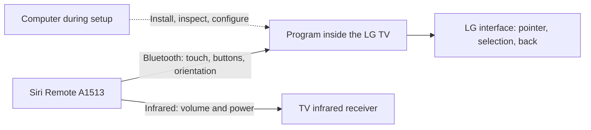
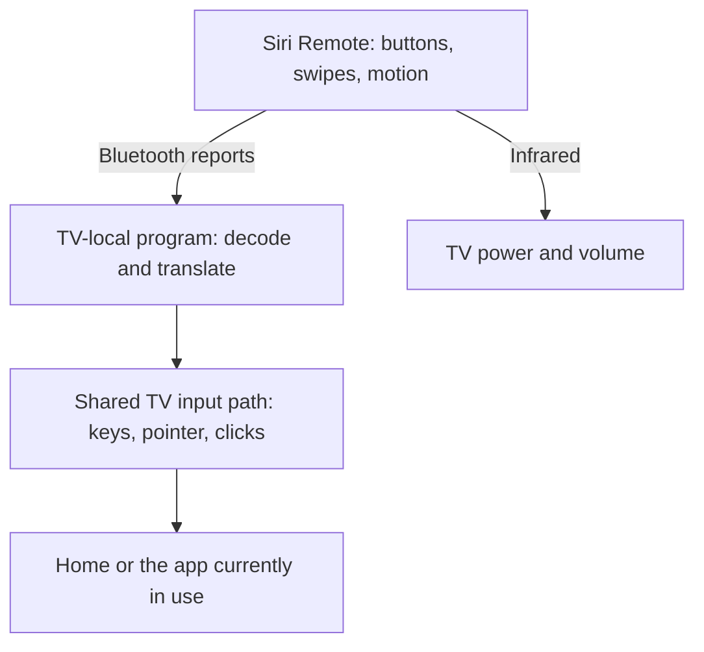
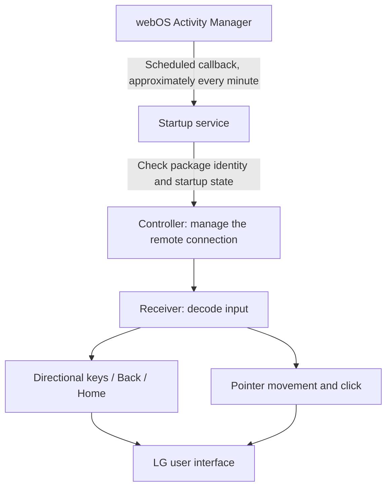
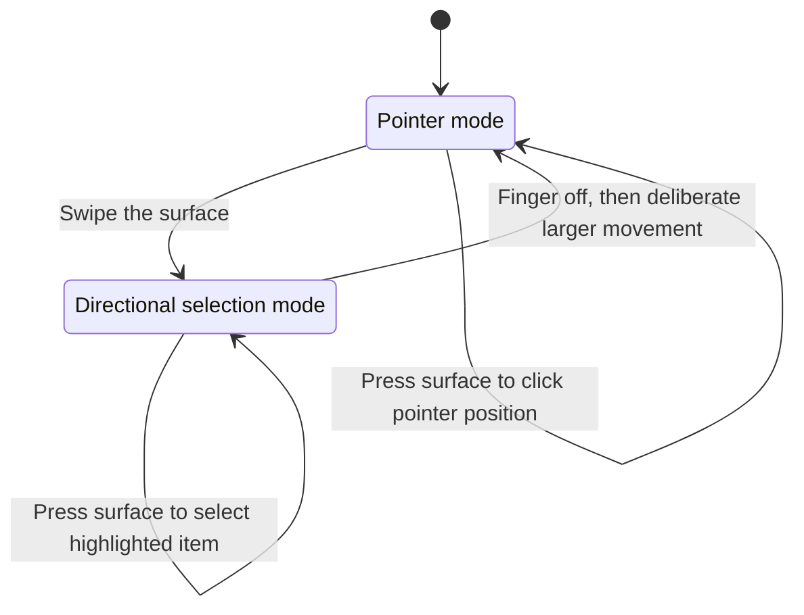
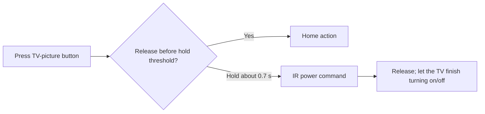
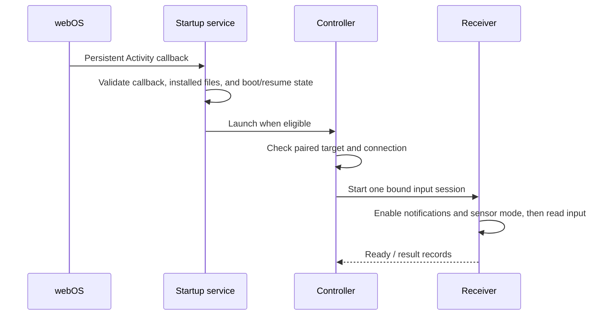
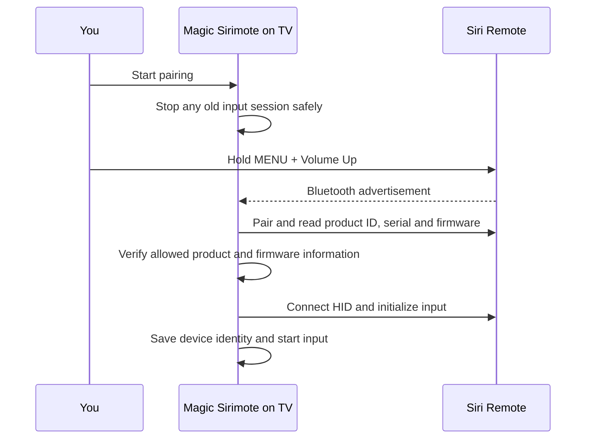

# Magic Sirimote

Thank you to the open-source Siri Remote and LG webOS communities—especially [open-appleremote](https://github.com/a-funk/open-appleremote), [SiriRemote-Linux](https://github.com/Yanndroid/SiriRemote-Linux), [Clean Your TV](https://github.com/Razdva122/clean-your-tv-lg-webos), and [webOSbrew](https://www.webosbrew.org/)—for sharing the tools, code, and discoveries that made this project possible.

**Use a first-generation Siri Remote to control an LG TV, with the input program running inside the TV.** Swipe to select an app, move the remote to move the pointer, press to select, go back, and control volume and power over infrared. No Mac, Apple TV, or other computer needs to stay on for everyday use.

The repository contains the TV runtime, package builder, configuration reference, and setup guide.

> **Compatibility:** the integrated app includes cable-free pairing, settings, input reception and automatic startup in one IPK. This has been tested on the A1513/LG G3 configuration below, including removal and recreation of its Bluetooth pairing. A1962 is also admitted for pairing and HID reception, but its operation on LG webOS has not been hardware-tested. Other hardware and a factory-fresh installation are not yet independently validated.

- [1. Tested Configuration](#1-tested-configuration)
- [2. What you can do](#2-what-you-can-do)
- [3. How it works](#3-how-it-works)
- [4. Setup guide](#4-setup-guide)

## 1. Tested Configuration

The tested hardware and software configuration is:

| Component | Model / version |
| --- | --- |
| Siri Remote | **First generation**, black, model **A1513** |
| Siri Remote main firmware | **0241** |
| Siri Remote radio firmware | **0107** |
| Television | **LG G3 — OLED55G3PJA** |
| webOS platform version (`sdkVersion`) | **11.2.0** |
| TV firmware (`firmwareVersion`) | **43.21.96** |
| Integrated TV app | Magic Sirimote **0.6.48** (integrated preview) |

The webOS platform version and TV firmware version are separate values. The platform version above is the `sdkVersion` reported by the TV's system-information interface.

## 2. What you can do

- Turn the TV on or off and adjust the volume using infrared.
- Go back, return to Home, and play or pause video.
- Swipe the touch surface to move the selection up, down, left, or right.
- Press the touch surface to click at the pointer position or select the highlighted item.
- Move the on-screen pointer with the remote's motion sensors, with your finger off the touch surface.

Button actions are configurable on the TV, including Back, Home, Settings, playback, screen off/restore and LG infrared codes. Voice input is not implemented. Pairing preserves the IR assignments already stored in the remote.

Normal TV off/on and automatic input resumption are verified on this configuration.

This reproduces many everyday Magic Remote interactions, not every function of LG's original remote. Keep the original remote available for setup and recovery.

## 3. How it works

### How the pieces fit together

There are two independent routes from the remote to the TV:



The computer is a setup tool. It is not a relay for normal button presses. Infrared also works independently of the TV input program once the remote has the correct IR configuration.

### How it controls other apps

Magic Sirimote translates the remote's Bluetooth reports into the TV's existing keyboard and mouse input events. It uses the `LGE RCU` input device for directions, selection and system buttons, and `ClickableMouse` for pointer movement and clicks. webOS routes those events to the current screen, including Home and other apps. Those apps do not need to be modified.



The two low-level mechanisms are different: Bluetooth setup uses internal webOS service methods; sending keys and pointer movement uses direct Linux input-device access (`/dev/input/...`). The running input programs use non-root app accounts with no effective Linux capabilities. The tested native-app environment provides the necessary device access. This is not a guarantee that an ordinary web-app service, another TV, or a future firmware grants the same access.

Inside the single installed package, three components divide the work:



The minute-based callback is for startup and recovery decisions. It does **not** mean the remote's input is processed once a minute. The receiver handles input continuously while running.

### Pointer and selection modes

Think of the touch surface as a small directional pad, and the whole remote as an air pointer.



1. **To navigate by selection:** swipe. The pointer disappears. Swipe again to move the highlight, then press the surface to open the selected item.
2. **To use the pointer:** lift your finger off the surface and make a deliberate movement with the remote. Once the pointer appears, smaller movements move it. Press the surface to click.
3. **After a fresh connection:** lift your finger off the touch area and move the remote normally. The pointer establishes its starting orientation from a brief continuous sequence of valid reports; you do not need to put the remote down or wait for it to become still.

Small hand movements after a swipe should not immediately bring the pointer back.

### Power button timing



Bluetooth actions for MENU, microphone, Play/Pause, and Home are dispatched when the button is released. Surface clicks keep their existing press/release behavior. Volume and stored IR actions run independently inside the remote.

The tested remote's threshold is approximately **0.716 seconds**, not a guaranteed wall-clock response time for the TV screen. Hold for a little under a second and release. Do not keep holding until the entire startup animation finishes. A power toggle is not a separate “on” or “off” command.

### Automatic startup and standby

“TV-local” means the program can run inside the TV. It does **not** mean it is permanently written into LG's firmware.



The implementation uses a persistent webOS **Activity**, roughly a recurring system callback. This is an internal startup mechanism, not a viewing/recording timer you must set in the TV guide. It keeps records so that a delayed callback or uncertain launch does not blindly start another input process.

### Source code and contributing

```text
src/
  check.py              # Host-only test runner
  build_integrated.py   # Current single-app IPK builder
  build.py              # Older configured three-package builder
  build_support.py      # Deterministic IPK archives and tiny ARM launchers
  runtime-files.json    # Explicit list of source modules allowed in packages
  ir_packets.py         # Pure IR configuration packet encoder; never transmits
  pairing/              # Cable-free pairing and bounded Bluetooth transport
  integrated/           # Native settings, first-run routing and bundled service
  runtime/              # Controller, receiver, decoding, lifecycle
  scheduler/            # Startup, standby, expiry service
  tv_inventory.py       # Read-only environment metadata on a TV
config.example.json     # Placeholder device identities and example UIDs
reviews/                # Public export verification results
tests/                 # Input, layout, and publication regression tests
  scheduler/           # Startup service tests and synthetic fixtures
```

Developers can run the regression suite with `python3 src/check.py`. It checks input decoding, navigation, lifecycle handling, and package construction using simulated device operations. It is a development check, not an installation step or proof of hardware compatibility.

Start with these files if you want to understand or adapt the behavior:

| Area | Source |
| --- | --- |
| MENU/microphone/Home/Play-Pause masks | [`system_buttons.py`](src/runtime/system_buttons.py) |
| Native LG key codes | [`system_key_sink.py`](src/runtime/system_key_sink.py) |
| Pointer versus selection mode | [`navigation_mode.py`](src/runtime/navigation_mode.py) |
| Click versus Enter output | [`grouped_prefix_output.py`](src/runtime/grouped_prefix_output.py) and [`output_bridge.py`](src/runtime/output_bridge.py) |
| Truncated report decoding | [`decoder.py`](src/runtime/decoder.py) |
| Orientation-based pointer | [`adaptive_prefix_pose.py`](src/runtime/adaptive_prefix_pose.py) |
| Connection supervision | [`resident_controller_entry.py`](src/runtime/resident_controller_entry.py) |
| Startup registration | [`creator.js`](src/scheduler/creator.js) |
| Standby resume checks | [`standby-resume.js`](src/scheduler/standby-resume.js) |
| Developer Mode maintenance | [`expiry.js`](src/scheduler/expiry.js), [`expiry-policy.js`](src/scheduler/expiry-policy.js) |

The runtime separates input decoding, device identity, connection management, process coordination, and verified shutdown. Scheduler tests live under `tests/scheduler`; package hashes are generated during the build. An explicit source inventory and dependency test define which modules belong in the packages.

Read [PORTING.md](docs/PORTING.md) for deployment requirements and handling of unsupported state records. Source provenance is recorded in [`docs/source-provenance.json`](docs/source-provenance.json).

Useful contributions include a verified clean-install workflow, additional TV/remote compatibility reports, better bounded status reporting, and investigation of complete touch-plus-orientation input. Include your model, firmware, steps, expected behavior, and actual behavior. Remove addresses, serials, tokens, private keys, and raw recordings from public reports.

### Credits and license

We are grateful to the authors and contributors of:

- **[open-appleremote](https://github.com/a-funk/open-appleremote)** — Siri Remote protocol documentation, input activation, button and touch research. Its documented captures must not be treated as proof of every behavior on our A1513/LG combination.
- **[SiriRemote-Linux](https://github.com/Yanndroid/SiriRemote-Linux)** — earlier first-generation Siri Remote investigation and implementation references.
- **[Clean Your TV for LG webOS](https://github.com/Razdva122/clean-your-tv-lg-webos)** — a valuable reference for TV-local native helpers and exploring the webOS application boundary.
- **[webOSbrew / Homebrew Channel](https://github.com/webosbrew/webos-homebrew-channel)** and **[webOS Dev Manager](https://github.com/webosbrew/dev-manager-desktop)** — community tooling and references for installation, services, and startup behavior. Homebrew Channel is not a bundled runtime dependency here.
- **LG's [webOS OSE Bluetooth service](https://github.com/webosose/webos.service.bluetooth2), [Luna Service 2](https://github.com/webosose/luna-service2), and [webOS developer documentation](https://webostv.developer.lge.com/)** — essential platform source and documentation.
- The Linux input, Python, Node.js, and LLVM communities whose tools underpin the implementation and build process.

Links credit research and tooling; they do not imply endorsement or identical compatibility. See [THIRD_PARTY_NOTICES.md](THIRD_PARTY_NOTICES.md) for scope. Project-authored code is under the [MIT license](LICENSE). Apple and LG names identify the hardware; this is an independent project.

## 4. Setup guide

### Before you begin

Have the tested first-generation Siri Remote, a compatible LG TV, the LG remote for setup, and a Mac or other computer on the same network as the TV. The TV needs Developer Mode and the Python/SDL libraries described in the [native app guide](docs/NATIVE_APP.md). A diagnostic cable is **not required for the tested pairing procedure**. Do not pair Siri Remote to the Mac first.

### Step 1: Connect your Mac to the TV

Install LG's [webOS CLI](https://webostv.developer.lge.com/develop/tools/cli-installation). Enable **Dev Mode Status** and **Key Server** in the TV's Developer Mode app. Run `ares-setup-device`, add the TV as `my-tv`, and enter its network IP address, port `9922` and user `prisoner`.

```sh
ares-novacom --device my-tv --getkey
ares-device --system-info --device my-tv
```

Enter the passphrase shown on the TV when prompted. If you already have a working CLI connection, use its device name instead. [Detailed connection steps](docs/NATIVE_APP.md#install-from-a-mac).

### Step 2: Install the single app

From the repository root:

```sh
ares-install --device my-tv releases/integrated-preview/org.magicsirimote.app_0.6.48_arm.ipk
ares-launch --device my-tv org.magicsirimote.app
```

Only this IPK is needed. Stop any older Magic Sirimote runtime and its automatic startup before replacing it; do not run competing receivers.

### Step 3: Pair Siri Remote on the TV

If the remote is already paired to this TV, Magic Sirimote opens its settings screen. Otherwise:

1. Use the LG remote to choose **Start pairing**.
2. Once searching begins, hold **MENU + Volume Up** on Siri Remote for about five seconds, then release both. Keep the remote near the TV.
3. Use Up/Down on the LG remote to select the matching candidate, then choose **Pair selected remote**. Finding a device does not pair it. A previously known remote may be selected and paired automatically using its saved identity.
4. The app checks the product ID, serial number and supported firmware before initializing input, then proceeds directly to setup completion. There is no fixed waiting period.
5. The app saves the verified connection information and starts reception. Check swipe, surface click and pointer movement. Reopen Magic Sirimote for settings.



Discovery requires first-generation Siri Remote product information and the HID service, rather than a name or Apple manufacturer ID alone. The connected remote must report Apple vendor ID `004C` and product ID `0266` (A1513) or `026D` (A1962). A1513 retains its validated firmware check. A1962 firmware is read for identification; accepting it does not establish compatibility of gyro operation or IR programming. Later Siri Remote generations are not supported. If verification fails, the app attempts to remove only the new pairing created by that attempt; existing registrations are preserved. These identifiers select compatible hardware, not cryptographic proof of authenticity.

A1962 pairing and basic input activation are based on [open-appleremote’s A1962 observations](https://github.com/a-funk/open-appleremote/blob/main/docs/PROTOCOL.md). The A1962 advertisement layout and this app’s full receiver still need a hardware test on LG webOS. IR programming continues to reject firmware outside the separately validated profile.

There are no Bluetooth address or device-name fields to fill out. Pairing does not change the remote's IR assignments. This cable-free path has been verified by deleting and recreating the tested remote's TV registration; a completely new remote/TV combination still needs compatibility testing.

### Step 4: Choose button actions and cursor sensitivity

Open **Button Assignments**. Each of the six buttons has a **Press** and **Hold** cell. All unconfigured cells default to **Do nothing**. Choose named actions or **Custom code (IR)** where needed, then return with Back and choose **Save and restart** on the first screen. This applies all twelve displayed choices, including unchanged ones: **Do nothing** removes that slot's IR entry and disables its TV-side action. Browsing or pairing alone does not change IR settings. Controls dim while saving; reception restarts when saving finishes.

For LG infrared control, useful selections are **Home (IR)** for TV / Control Center Press, **Power on/off (IR)** for its Hold, and **Volume + (IR)** / **Volume - (IR)** for the volume buttons. The delayed IR power entry requires an immediate IR entry on the same button. The app checks this combination before writing. Test the actual response after saving. See [IR.md](docs/IR.md) for custom codes and limitations.

The main screen also provides **Gyro cursor**, a five-step sensitivity slider, and **Reset cursor orientation**. Sensitivity changes travel distance without changing response timing. [Settings and recovery details](docs/NATIVE_APP.md#settings).

### Everyday use

The Mac can be off. A surface press wakes a sleeping Siri Remote. Swiping switches to directional selection; lift your finger and make a deliberate larger movement to return to pointer control. IR volume and power work independently of the running app once configured.

Automatic startup is included. A full TV reboot may need about a minute for the scheduled startup check plus Bluetooth connection time. Developer Mode expiry must still be managed using LG's usual tools; automatic startup does not extend it.

To remove this remote and start over, choose **Reset app** and confirm **Reset everything**. This also deletes all of the remote’s infrared button assignments, including power and volume. Use the LG remote during reset. [Reset and unpair details](docs/NATIVE_APP.md#reset-and-unpair).

### If something does not work

- **IR works but swipe/cursor does not:** wake the remote and check pairing/reception. IR and Bluetooth are independent.
- **No remote appears during pairing:** keep it near the TV and perform MENU + Volume Up while searching is active. A listed candidate alone is not a completed pairing.
- **Pairing fails:** keep the displayed result. The app stops an uncertain attempt instead of repeating writes. The pairing guide distinguishes discovery, pairing, HID initialization and retention.
- **Cursor directions feel rotated:** place the remote flat, top up and tip toward the TV, then use the LG remote to select Reset cursor orientation.
- **A save is incomplete:** completed assignments may already be saved. Inspect the result using the LG remote before trying again.
- **Bluetooth or sensor cleanup fails:** preserve the runtime records. Do not delete state or repeatedly reset connections to bypass a refusal. Some development recovery cases may still need a diagnostic cable.

Keep the exact IPK, its checksum and your known IR assignments before updating. A package backup is not a full backup of the remote's memory. Removing the TV app does not remove IR codes stored in Siri Remote. Read the [native app guide](docs/NATIVE_APP.md) and [porting notes](docs/PORTING.md) before deploying on different hardware.
