# Magic Sirimote

**This project was developed through Vibe Coding:** an AI coding agent wrote and revised the code, with a human directing the work and testing it on real hardware.

Thank you to the open-source Siri Remote and LG webOS communities for the tools, code and discoveries that made this possible. In particular, this project owes much to [open-appleremote](https://github.com/a-funk/open-appleremote), [SiriRemote-Linux](https://github.com/Yanndroid/SiriRemote-Linux), [Clean Your TV](https://github.com/Razdva122/clean-your-tv-lg-webos), and [webOSbrew](https://www.webosbrew.org/).

Magic Sirimote lets a first-generation Siri Remote control an LG webOS TV. Install one app on the TV, pair the remote in that app, and choose your button assignments. **Your Mac does not need to stay on after setup. No Apple TV is needed.**

This is an experimental community project with limited hardware testing. Reconnection and recovery are still being improved. Keep the original LG remote available.

- [Compatibility and requirements](#compatibility-and-requirements)
- [Set up from a Mac](#set-up-from-a-mac)
- [Troubleshooting](#troubleshooting)
- [Reset or uninstall](#reset-or-uninstall)

## Compatibility and requirements

### Tested hardware

| Component | Tested model or version |
| --- | --- |
| Siri Remote | First generation, black, **A1513** and **A1962** |
| LG TV | **LG G3 — OLED55G3PJA** |
| webOS platform version | **11.2.0** (`sdkVersion`) |
| TV firmware | **43.21.96** |

These are tested examples, not a model or firmware allowlist. The app and TV-side fix do not require these specific LG versions. The installer checks the runtime features needed by the supplied package and explains any missing requirement. This ARM package currently needs a 32-bit ARM Python 3.10+ runtime, Luna Service 2, GLib, SDL2 and SDL2_ttf on the TV; input also depends on the TV's Bluetooth and input-device APIs. Other webOS environments may need a matching build or platform support.

The webOS platform version and TV firmware version are different values. You do not need to look up the remote's firmware before starting; the app verifies its identity during setup.

Both models have been tested for pairing, infrared assignments, swipes, touch-surface clicks, and gyro pointer control. Later, silver Siri Remote generations are not supported.

## Set up from a Mac

**Use Magic Sirimote to pair the remote. The TV's standard Bluetooth device settings cannot complete the Siri Remote pairing used by this app.**

Do not pair Siri Remote with the Mac. The Mac installs the app; the TV app pairs directly with Siri Remote. You will enter the TV's network IP address on the Mac.

### 1. Install the Mac tools

Install the current **LTS version of [Node.js with npm](https://nodejs.org/en/download)**, then reopen Terminal. Node.js 20 or newer is required by the webOS command-line tools.

The installer checks for LG's **[webOS CLI](https://github.com/webos-tools/cli)** and offers to install it automatically with npm if it is missing. If you prefer to install it beforehand:

```sh
npm install --global @webos-tools/cli
```

The other tools (`curl`, `tar`, and, for the optional TV-side fix, `ssh`) are included with macOS. Missing tools and installation failures are explained before continuing.

### 2. Prepare Developer Mode on the TV

1. Create an account on the [LG webOS TV Developer website](https://webostv.developer.lge.com/) if you do not have one.
2. Install **Developer Mode** from the TV's app store, open it and sign in.
3. Turn **Dev Mode Status** on. Initial activation requires the TV restart requested by LG. **If it is already on, leave it on.**
4. Open Developer Mode and turn **Key Server** on. Keep its **IP address** and **passphrase** available for the installer.
5. Connect the Mac and TV to the same local network.

See [LG's Developer Mode guide](https://webostv.developer.lge.com/develop/getting-started/developer-mode-app) if the TV needs help completing this step.

### 3. Run the installer

Paste this into Terminal to download and run the interactive installer:

```sh
curl --fail --location --output install.sh https://raw.githubusercontent.com/super-dog-human/magic-sirimote/main/install.sh && sh install.sh
```

Choose **Install/update app**. Enter the TV's IP address when asked; press Return to accept the suggested port. The installer reuses a matching saved connection or creates one. If a key is needed, enter the passphrase shown in Developer Mode, **not your LG account password**.

The installer checks compatibility, verifies the download, installs the IPK and verifies the installed files. When updating, it first asks you to close unsaved settings and wake Siri Remote so the running app can stop cleanly.

During installation, you can also apply the **TV-side input-device fix**. This prevents input loss after repeated Bluetooth reconnections. It requires an **existing root SSH connection**; the installer asks for its port and optional key file. It does not obtain root access, and the Developer Mode passphrase is not a root password. If you have no root connection, answer **n** to continue installing the app.

The fix changes LG's handling of A1513/A1962 outside this app as well; other remote models pass through. Applying or removing it briefly restarts the input service, **not the TV**. It checks the service's interfaces and storage rather than requiring a particular TV model or firmware. Without the fix, the repeated-reconnection problem may recur. See [Reset or uninstall](#reset-or-uninstall) to remove it.

When installation finishes, Magic Sirimote opens on the TV. The installer does not reboot the TV. You can run the same `sh install.sh` again to update or uninstall.

### 4. Pair Siri Remote with the TV

Open **Magic Sirimote** on the TV. If it is not already open, select this icon from the TV's Home screen:


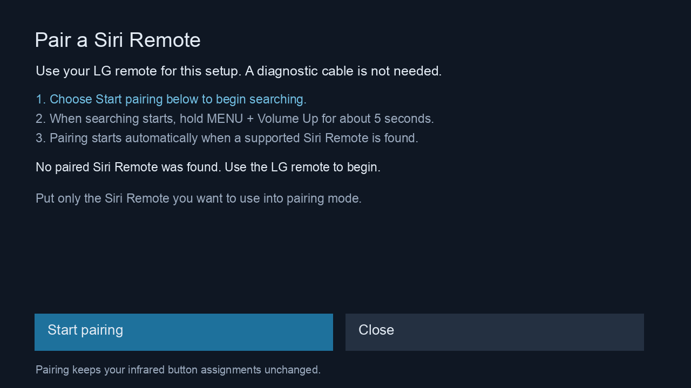

The app shows **Pair a Siri Remote**. If it opens the settings screen instead, continue to [Choose all of your button assignments](#5-choose-all-of-your-button-assignments).

1. On the TV, choose **Start pairing** with the LG remote.
2. Wait until the app starts searching. **Start the search before pressing the pairing buttons.**
3. Hold Siri Remote near the TV. Press and hold **MENU and Volume Up (+) together for about five seconds**, then release both.
4. The app automatically pairs with the first available supported Siri Remote it finds. **Put only the remote you want to use into pairing mode.** If this app already has a saved remote, the search stays restricted to that remote. No **Pair selected remote** step is needed in v0.4.0.
5. Wait while the app verifies the remote and prepares input. On success, it saves the connection information and closes the window to start reception. If the search expires, choose **Search again** and repeat the pairing-button sequence.
6. Press Siri Remote's touch surface once to wake it. Try swiping to move the TV's selection, then pressing and releasing the surface to select an item.

<details>
<summary>Connection check and search screens</summary>

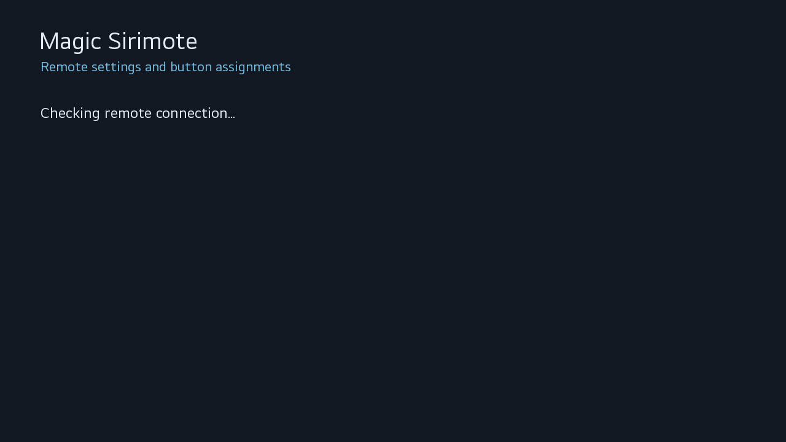

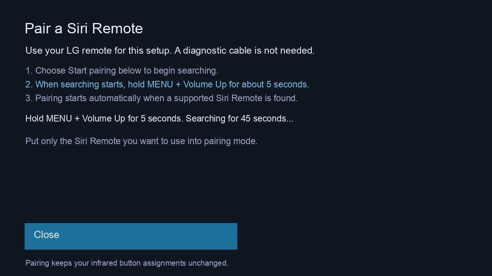

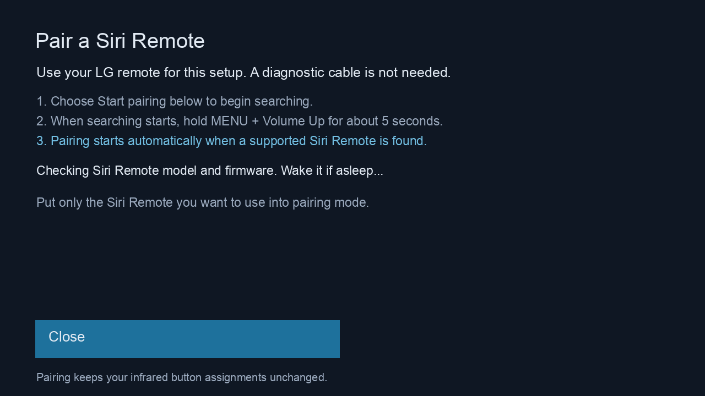

These pairing illustrations are rendered from the v0.4.0 UI code.

</details>

If the app reports an error or no candidate appears, see [Pairing problems](#pairing-problems).

### 5. Choose all of your button assignments

Reopen **Magic Sirimote** from the TV's Home screen using the LG remote. Choose **Button Assignments**.

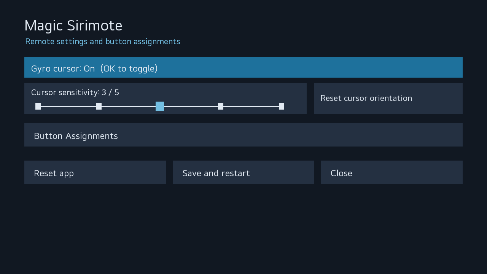

The six rows are **Menu**, **TV / Control Center** (the button with a TV picture), **Siri** (the microphone button), **Play/Pause**, **Volume Up**, and **Volume Down**. Touch-surface clicks and swipes are separate and do not need button assignments.

Use the LG remote's direction keys to select a cell, press OK to open its choices, and select an action. Siri Remote can also navigate these screens when reception is working, but keep using the LG remote for saving.

Here is a useful starting configuration. **It is a suggestion, not a preset applied automatically:**

| Button | Press | Hold (~0.7 s) |
| --- | --- | --- |
| Menu | Back (IR) | Do nothing |
| TV / Control Center | Home (IR) | Power on/off (IR) |
| Siri | Screen off / restore | Do nothing |
| Play/Pause | Play / Pause | Do nothing |
| Volume Up | Volume + (IR) | Do nothing |
| Volume Down | Volume - (IR) | Do nothing |

The screenshot below uses the suggested assignments above.

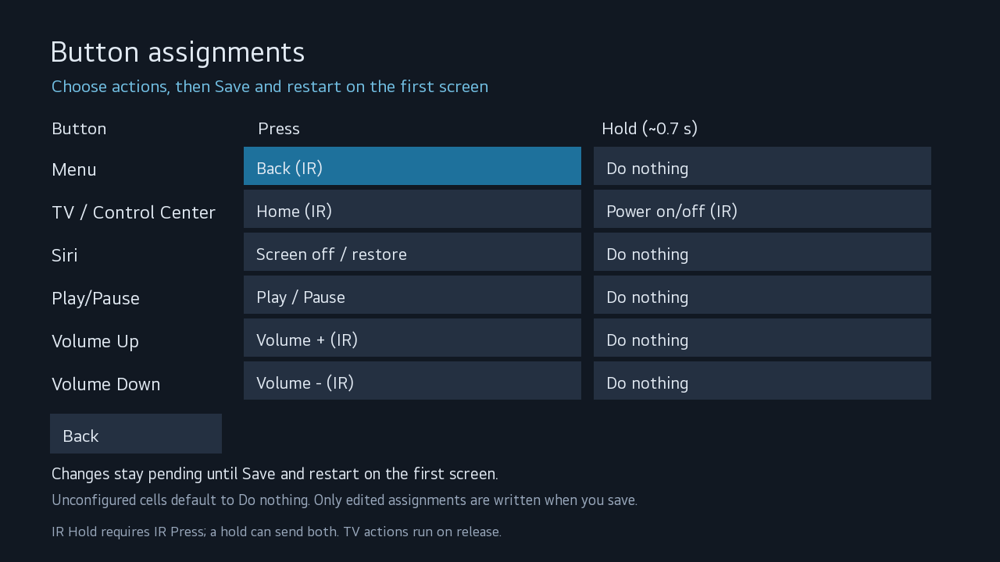

<details>
<summary>Action choices and custom IR code entry</summary>

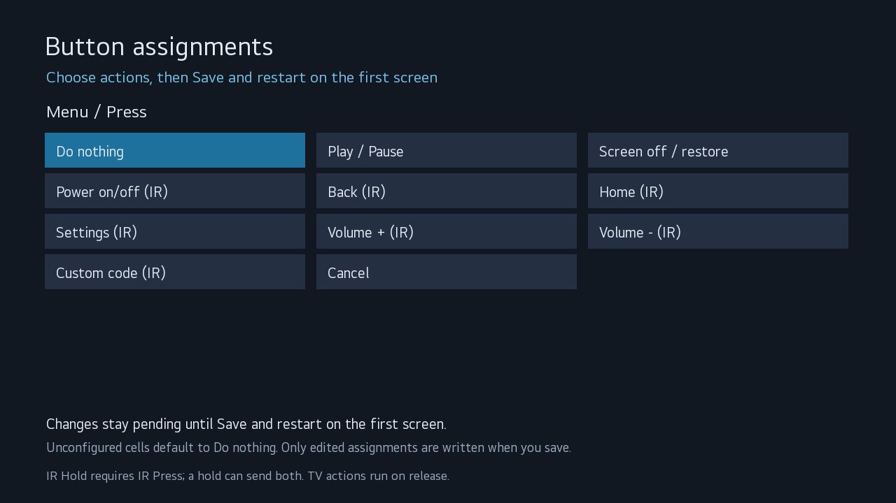

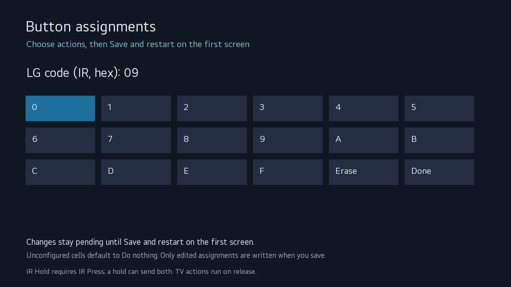

</details>

**What “IR” means:** the remote itself sends infrared light to the TV. Point its front end toward the TV's infrared receiver. Configured IR power and volume can work even when the app's Bluetooth input is unavailable. Choices without “(IR)” are handled by the app running on the TV.

**How Press and Hold interact:** an IR Press action is sent immediately and may also happen at the beginning of a long hold. For example, holding the suggested TV button can send Home first, then Power. If you assign an IR action to Hold, also assign an IR action to Press on that button. A hold-only IR assignment can fire on a short press, so the app prevents that combination.

**What “Do nothing” means:** on an unconfigured app, all twelve cells display Do nothing. That display is not a readback of the remote's existing infrared memory. Explicitly choosing Do nothing and saving removes that slot's IR assignment and disables its TV-side action. Unedited buttons are left unchanged. To disable a button completely, set both its cells to Do nothing.

Choose every cell you want to use before your first save. The app cannot recover an unknown infrared assignment after you overwrite or delete it.

### 6. Save your settings

1. Press **Back** to return to the first settings screen. Your button edits remain pending.
2. Leave **Gyro cursor** on if you want pointer control.
3. Choose **Save and restart**. The app applies your edited assignments and restarts reception.
4. Wait for the window to close, then use Siri Remote.

If saving fails partway through, some assignments may already have changed. Read the displayed result and press Siri Remote's touch surface once to wake it before retrying. Selecting a choice or leaving the editor with Back does not itself save anything. **Close** asks whether to discard unsaved edits, then returns to Home. Back from the first settings screen also returns to Home.

<details>
<summary>Unsaved changes confirmation</summary>

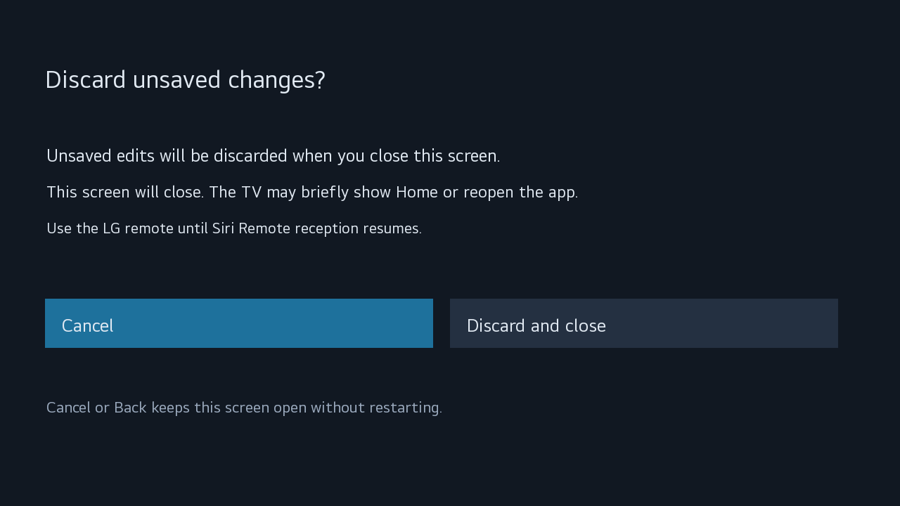

</details>

## Troubleshooting

### Keep Developer Mode active

Periodically open **Developer Mode** on the TV and check **Remain Session**. While time remains and the TV is online, use **EXTEND** to renew it. Magic Sirimote does not renew it for you. If Developer Mode becomes disabled, LG removes the apps installed through it. See [LG's session instructions](https://webostv.developer.lge.com/develop/getting-started/developer-mode-app#extending-developer-mode-time).

### The Mac cannot connect to the TV

Confirm that the TV is on, Dev Mode Status is on, and both devices are on the same local network. Run `sh install.sh` again and enter the current IP address shown by the TV; a previously saved address may have changed.

If key authentication fails, turn Key Server on and let the installer retrieve the key with the current on-screen passphrase. Do not switch Developer Mode off and on merely to refresh an IP address or key.

### The app does not open

Open Magic Sirimote from the TV's Home screen. If installation reported an error, rerun `sh install.sh` and follow its message before retrying.

### Pairing problems

- Start searching in the app **before** holding MENU + Volume Up. Release both buttons after about five seconds and keep the remote near the TV.
- Charge the remote if necessary, then disconnect its cable before testing input.
- If no candidate appears, choose **Search again** when offered and repeat the sequence.
- Pairing starts automatically when a supported, available remote is found. Put only your intended remote into pairing mode; wait for identity verification to finish. If the search expires, choose **Search again**.
- If remote identification fails, record the exact message. A name resembling “Siri Remote” is not sufficient for acceptance.

The pairing used by Magic Sirimote may not appear in the TV's ordinary Bluetooth-controller list. An empty list there does not by itself mean pairing failed. Use Magic Sirimote's own screen and test input instead.

### The remote does not respond after being idle

Siri Remote can go to sleep after a period of inactivity. **Press the touch surface down once to wake it**, then swipe or move the remote. Simply touching or swiping the surface may not wake it. Allow a moment for Bluetooth to reconnect. If it still does not respond, follow the checks below.

### Restart Siri Remote

If the remote remains unresponsive, restart the remote itself:

1. Disconnect its charging or diagnostic cable.
2. Press and hold **TV / Control Center** (the TV-picture button) and **Volume Down (−)** together for about **five seconds**.
3. Release both buttons and wait **5–10 seconds**.
4. Press the touch surface once, allow Bluetooth to reconnect, and try swiping again.

This is the remote-restart button sequence documented by [Apple](https://support.apple.com/en-us/102569). Apple TV status-light and connection messages in that guide do not apply to an LG TV. This is separate from Magic Sirimote's destructive **Reset app** command; do not choose Reset app just to restart the remote.

### Only power or volume works

Infrared and Bluetooth operate independently. Working IR buttons do not confirm that Bluetooth reception is working.

1. Press the touch surface once, then try a few swipes. Allow time for reconnection, especially just after turning on the TV.
2. With the LG remote, open Magic Sirimote and read any message. If a settings window was left open, choose **Close**, then try Siri Remote again.
3. Check that Developer Mode is still enabled.
4. If input remains unavailable, try a normal TV power-off/power-on with the LG remote, then press Siri Remote's touch surface once to wake it.
5. If normal power cycling does not help, a full restart may clear a stuck Bluetooth state: when the TV is not updating, turn it off, unplug it for about 30 seconds, reconnect power, and turn it on. Allow startup time before testing again.

Recovery is not guaranteed for every Bluetooth failure. If the problem keeps returning, report it rather than repeatedly resetting pairings or deleting app files. Include whether swipes, surface clicks, cursor movement and IR still work, and whether the problem followed sleep, power-on or saving settings.

### Bluetooth connects, but input remains unavailable

After repeated reconnections, LG's input manager can retain old input-device references until Siri Remote receives a device number that the app cannot access. Run the [installer](#3-run-the-installer) and choose the TV-side fix when offered. Updating the app IPK alone does not apply it.

Without root access, a full TV restart is a temporary recovery option: when the TV is not updating, turn it off, unplug it for about 30 seconds, reconnect power, and turn it on. This does not prevent recurrence. **Reset app is not needed for this recovery.**

### Swipes work but the pointer does not

Check that Gyro cursor is on and saved. Lift your finger completely off the touch surface and move the remote more deliberately. If movement is misdirected, lay the remote flat with its touch surface up and front end toward the TV. Choose **Reset cursor orientation**, confirm **Restart**, and leave the remote still until reception resumes. A working swipe does not necessarily mean orientation setup has completed yet.

<details>
<summary>Cursor orientation reset confirmation</summary>

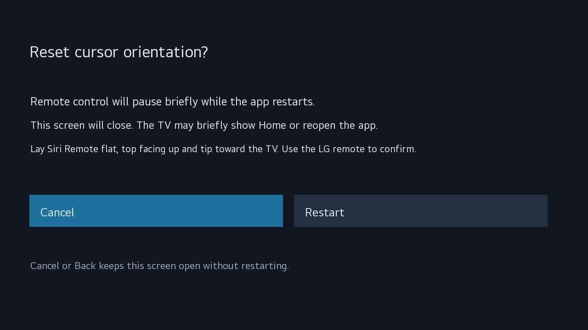

</details>

### Voice input

Voice input is not supported.

## Reset or uninstall

**Reset app is destructive.** It removes this remote's TV pairing, the app's active settings, and all short- and long-press infrared assignments on the remote, including power and volume. It also clears the surface-click IR entries, which are not exposed in the six-row editor. It does not reset the TV or remove other Bluetooth devices. It is not a factory-firmware reset of Siri Remote.

To start over:

1. Have the original LG remote ready, then press Siri Remote's touch surface once to wake it.
2. Open Magic Sirimote and choose **Reset app**.
3. Read the confirmation. Choose **Cancel** to leave things unchanged, or **Reset everything** to proceed.
4. Let the reset finish. If it stops partway through, read the error; reopening the app may offer **Continue reset** to finish the remaining steps. Some IR assignments may already be deleted.
5. When **Start pairing** appears, follow [Pair Siri Remote with the TV](#4-pair-siri-remote-with-the-tv), then configure and save your button assignments again.

<details>
<summary>Reset confirmation screen</summary>

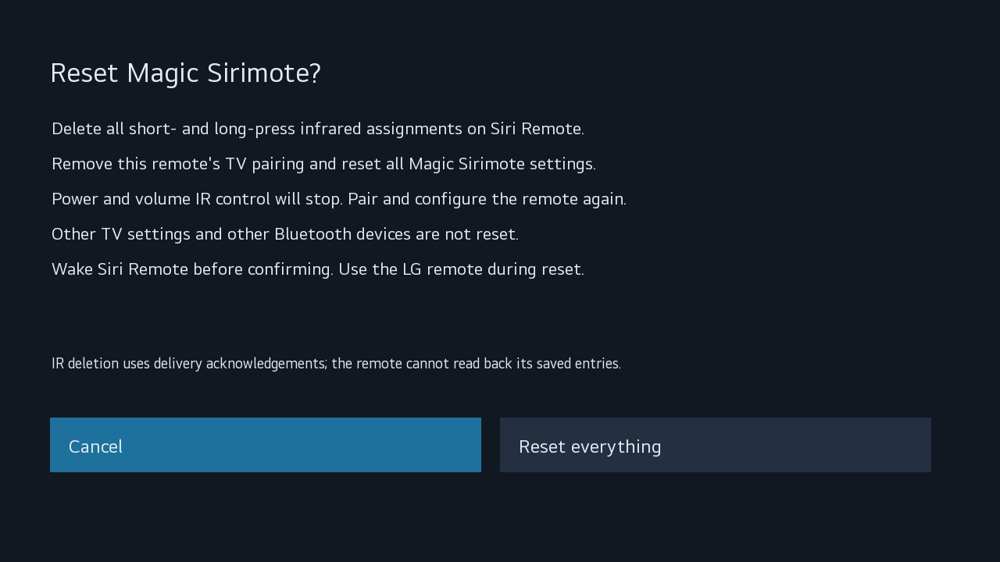

</details>

To uninstall Magic Sirimote:

1. If you also want to remove its remote pairing and infrared assignments, complete **Reset app** first.
2. Run `sh install.sh` on the Mac and choose **Remove app**. It also offers to remove the TV-side fix using your root SSH connection.

You can instead delete Magic Sirimote using **Edit App List → Delete** on the TV's Home screen. Wait for deletion to finish before reinstalling.

**Deleting or resetting the app does not remove the TV-side fix:** the app's uninstall process cannot perform its root cleanup. To remove it separately, run `sh install.sh` and choose **Remove TV-side fix only**, even if you already deleted the app. Only the input service is restarted; the TV is not rebooted.

Uninstalling the app alone should not be treated as unpairing the remote or deleting its stored IR settings. Reset clears the active configuration but may retain inactive local recovery records; it is not secure erasure of diagnostic history.
