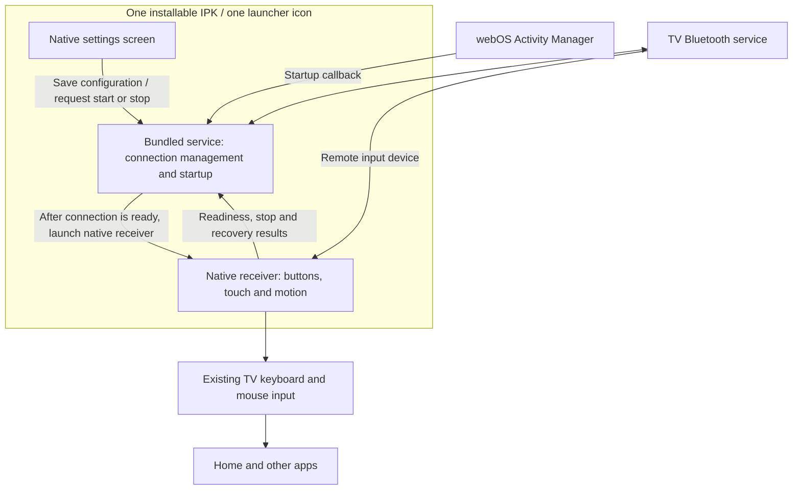

# Native app

There are two preview packages: the integrated runtime described first, and a
settings-only preview described separately below. Both use the same app ID;
installing one replaces the other.

## Integrated runtime build

[Download the integrated runtime preview](../releases/integrated-preview/org.magicsirimote.app_0.6.9_arm.ipk)
and [its SHA-256 checksum](../releases/integrated-preview/SHA256SUMS).
You can also build the package from source:

```sh
python3 src/build_integrated.py --out /tmp/magic-sirimote-integrated
```

Choose a new output directory. This build contains the native window, input
receiver and bundled background service in one IPK. It is separate from the
downloadable setup preview below. It requires an already paired remote and
verified device settings; a fresh-install pairing workflow is not yet available.
This is not an automated migration from the separate controller, receiver and
startup apps. Their input processes and startup registration must be stopped
and verified before starting the integrated runtime.

The settings window provides **Start remote control** and **Stop remote control**.
Start registers and enables automatic startup, then closes the window while the
connection is prepared. Opening the app again shows its settings. Stop disables
automatic startup and stops input; it remains disabled across TV restarts until
you choose Start again. Stop and wait for cleanup before programming infrared or
updating the package.

Automatic startup uses one persistent webOS Activity owned by this same app.
No separate startup app or running Mac is needed. The bundled service watches the
TV's power state, stops input for standby, and starts it after power returns.
Turning off only the screen keeps input available so the microphone button can
restore the picture. After a complete TV restart, allow up to about a minute for
the scheduled service to run, followed by the Bluetooth connection time. A
sleeping remote may need a button press to wake it. Developer Mode expiry remains
your responsibility; automatic startup does not extend it.

The service keeps a durable record of each automatic start attempt. If startup
fails or a previous sensor session cannot be safely recovered, it retains the
records and does not repeatedly launch new input processes. The saved settings
and recovery records should not be deleted as a troubleshooting shortcut.

The integrated window reads the battery level whenever you open or reopen it,
using the receiver's existing authenticated Bluetooth connection. It shows
**Battery: reading...**, then the percentage, without an elapsed-time label.
A missing connection, invalid response or timeout shows **Battery: unavailable**;
a value from a previous screen opening is never substituted. The read runs
asynchronously so input continues. There is no periodic polling while the screen
stays open, and reading the level does not connect or re-pair the remote.
Connection setup also reads the battery once.

On the tested TV, this build supports swipe navigation, surface clicks, gyro
pointing, MENU for Back, the TV button for Home, playback controls, and releasing
the microphone button to toggle screen off/restore. The saved gyro preference
and configurable TV assignments are not yet connected to this runtime. Remote
IR assignments already stored in the Siri Remote continue to work independently.

## Try the setup preview

[Download the native setup preview](../releases/native-preview/org.magicsirimote.app_0.2.7_arm.ipk) and [its SHA-256 checksum](../releases/native-preview/SHA256SUMS).

This package contains a native settings screen, a remote-friendly character picker, settings validation and a non-mutating input-access check. It contains **no device addresses or serial numbers**. Saving settings changes only this app's saved configuration. It does not pair a remote, start remote control or register automatic startup. The **Buttons** screen provides a list of all seven physical buttons and separate normal/long-press selectors. It offers named LG actions and direct two-digit code entry, and can explicitly set or delete one stored assignment; it never writes automatically. The new IR integration is not yet hardware-validated.

The preview requires the same tested G3 environment, including the TV's 32-bit Python 3.10+ interpreter, SDL2 and SDL_ttf. It uses a font already installed on the TV. These dependencies are not bundled. Other TV models remain unverified.

## Install on a TV

These commands install the settings preview only. They do not pair a Siri Remote,
start input reception, or migrate an existing controller/receiver/startup installation.
Keep the working three packages installed. No diagnostic cable is needed to
install or open this preview.

### First connection from a Mac

Skip this section if your Mac already connects to the TV with the LG CLI.

1. Install the [webOS CLI](https://webostv.developer.lge.com/develop/tools/cli-installation)
   and connect the Mac and TV to the same network. If you have an older CLI,
   follow LG's migration instructions instead of installing competing versions.
2. On the TV, install **Developer Mode** from LG Apps, sign in, and enable
   **Dev Mode Status**. First-time activation reboots the TV. If it is already
   On, leave it On. Reopen the app and enable **Key Server**.
3. Run `ares-setup-device` on the Mac and select **add**. Use `my-tv` as the device
   name (or substitute your own name below), the TV's network IP address,
   port `9922`, and user `prisoner`. The network IP is not a Bluetooth address.
4. Retrieve the connection key, entering the passphrase shown on the TV:

   ```sh
   ares-novacom --device my-tv --getkey
   ares-device --system-info --device my-tv
   ```

   Continue when system information is returned successfully. See
   [LG's connection guide](https://webostv.developer.lge.com/develop/getting-started/developer-mode-app).

### Install and open the preview

Run from the repository root. Replace `my-tv` with the registered device name.
Install only the latest IPK; older IPKs are not dependencies.

```sh
ares-install --device my-tv releases/native-preview/org.magicsirimote.app_0.2.7_arm.ipk
ares-launch --device my-tv org.magicsirimote.app
```

The TV should show **Magic Sirimote** with device fields and **Gyro cursor**.
It can also be opened later from the TV launcher as **Magic Sirimote Setup**.
If it does not appear, installation or launch is not verified; do not infer
success merely because the file was transferred. The native dependencies listed
above still need to be present on the TV.

1. Use the original LG remote's arrows and OK button to enter the device
   identities. A USB keyboard can also enter text. **Save settings** saves them.
2. Select **Check this TV**. It opens and closes the existing input-device nodes
   without reading or sending input. A successful check establishes access only;
   it does not verify pairing or remote-control operation.
3. **Gyro cursor** defaults to On. Its On/Off choice and **Buttons → Screen off /
   restore (TV)** can be saved, but do not affect the current input runtime yet.
4. IR programming is a separate operation. Before using **Set** or **Delete**
   for an IR action, complete the prerequisites in [the IR guide](IR.md), including
   stopping the input runtime and automatic restarts. This preview has no
   Stop/Resume control. Opening the app alone never programs the remote.
5. Select **Close** when finished. No background receiver starts.

### Update an existing preview

Wait for any IR operation to finish and close the preview using its **Close**
button. Note your device fields, gyro choice and saved TV assignments before
updating. Retain any operation receipts you need separately; they are not a
readback or backup of the remote's IR memory.

Install the newer IPK using the same `ares-install` command above, then launch
it with the same app ID. Do not uninstall first as a routine update step.
Settings retention across webOS package replacement has not been verified for
this preview: check the values after reopening and re-enter them if needed.
This update does not modify the separately installed three-package runtime.

### Remove only this preview

After any pending IR operation has finished and the preview is closed:

```sh
ares-install --device my-tv --remove org.magicsirimote.app
```

Removing the app does not undo IR commands already stored in the Siri Remote.
Do not rely on its local settings or receipts surviving removal. Developer Mode
expiry is managed separately using your usual tools.

The install, launch, list and remove commands are described in the
[LG CLI guide](https://webostv.developer.lge.com/develop/tools/cli-dev-guide).

## Package contents

The preview contains 15 payload files: ten Python modules, one small ARM launcher,
an icon, app metadata, package metadata, and `state/README.txt`. All Python modules
are reachable from the launcher's entry point. `native_probe.py` is the active
startup wrapper despite its historical name; it is not an unused diagnostic.
`state/README.txt` supplies the initial private state-directory placeholder.

The old controller, receiver and scheduler, test files, build tools, bytecode
caches, logs, saved identities, operation receipts and previous IPKs are not
bundled. Builds use an explicit source list and start in a new output directory;
they do not package an old working directory wholesale. The package test checks
the exact inventory and module reachability.

Only app and package directories are installed; this preview contains no bundled
service. The Python/SDL/font dependencies are supplied by the tested TV, which
is why the IPK is small. A small package does not imply compatibility with every TV.

This describes the IPK itself. It is not an inventory or cleanup of files already
on a TV from earlier installations.

## Settings

Only these device identities are entered manually in the preview:

| Field | What to enter |
| --- | --- |
| Remote Bluetooth address | The Siri Remote's Bluetooth address, such as `AA:BB:CC:DD:EE:FF`; not the TV's Wi-Fi or Ethernet address |
| Remote device name / serial | The exact name reported for the remote's HID identity; preserve upper/lower case |
| TV Bluetooth address | The TV's Bluetooth adapter address |

**Gyro cursor** is a simple **On / Off** setting, with **On** as the default.
Select the row and press OK to toggle it, then choose **Save settings**.
The preference is retained when the app is reopened. Older settings files
without this field are treated as On. The intended Off behavior disables only
motion-driven cursor movement; swipe navigation and button actions remain.

In this native preview, the preference is saved but **not applied to the input
runtime yet**. The existing three-package runtime is also unchanged. The UI
reports this after saving. The value is stored as the boolean `gyroEnabled` in
`state/settings.json`; invalid non-boolean values are rejected.

Entering these values **does not create a pairing**. A pairing/setup workflow still has to be integrated. The app's account identifiers and input-device paths are implementation details to discover on the TV, not information users should have to guess. The setup preview does not accept LG account credentials or Developer Mode tokens.

The intended complete app will also provide Start/Stop controls and automatic-startup provisioning. Those controls are not included in this preview. IR Set/Delete is implemented; a full-table readback or factory-default restoration is not provided.

## Intended single-package design



One app does not require one process. The service can manage a connection while the native receiver handles input. The native receiver needs to be launched after the remote's input device is available: the native environment exposes some device nodes when the app starts. Creating a child inside an older environment is not a substitute for obtaining a fresh native launch.

A JavaScript service is not a Web app. JavaScript is used for the service plumbing; the visible application and the input-capable process use the native app environment.

## What has been verified

On the tested G3, an isolated single-IPK probe demonstrated all of the following without starting another remote-input session:

- A bundled service can retrieve Bluetooth HID and GATT connection status.
- That service can launch the native application from the same package.
- The native process can verify the live service-side helper's process identity and read its request from their shared service directory.
- The native process can open the TV's `LGE RCU` and `ClickableMouse` input devices and return a result to the service.
- Both processes run under non-root accounts with no effective Linux capabilities.
- The TV's SDL2 and SDL_ttf libraries can render a native screen and close it normally.

The service itself cannot see `/dev/input` or the application directory, so placing the receiver directly inside a normal service does not work. The native process can see the bundled service directory. The proposed layout uses that shared location for the two roles' code and handoff state, preserving process and file verification.

**Still to integrate and verify:** the real controller/receiver handoff, sensor shutdown and crash recovery, opening settings while input is active, startup after full boot, standby/resume, first pairing and on-TV validation of the new IR Set/Delete screen. The preview must not be presented as a completed one-app remote-control release.

## Build from source

From the repository root, with Python and ARM-capable Clang installed:

```sh
python3 src/build_native.py --out build/native-preview
python3 -m unittest discover -s tests -p 'test_native_*.py'
```

The build writes one generic IPK, `SHA256SUMS` and a manifest describing the preview's limited purpose. It never contacts a TV. No per-TV configuration is required to build it. The existing `src/build.py` continues to build the separate controller/receiver/startup packages.

Source files are in [`src/native`](../src/native). Installed settings and IR operation receipts belong to the app's `state` directory; do not include that directory in a public bug report.

References: [webOS Homebrew native development](https://www.webosbrew.org/pages/native-development.html) describes native applications and the available graphics libraries; [LG's app/service template guide](https://webostv.developer.lge.com/develop/getting-started/app-template) describes packaging an app with services. Neither reference guarantees the measured permissions on other firmware.
