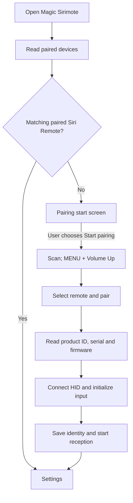

# Native app

## Integrated runtime build

[Download Magic Sirimote 0.6.43](../releases/integrated-preview/org.magicsirimote.app_0.6.43_arm.ipk) and [its SHA-256 checksum](../releases/integrated-preview/SHA256SUMS).

One IPK contains the native settings window, input receiver, connection controller and startup service. No computer stays in the input path after installation. The app uses the TV's existing Python 3.10+, SDL2 and SDL_ttf libraries and a TV-provided font; these dependencies are not bundled. The tested configuration is the A1513 Siri Remote and LG G3 listed in the [README](../README.md#1-tested-configuration). Other models and factory-fresh installations remain unverified.

## Install from a Mac

1. Install LG's [webOS CLI](https://webostv.developer.lge.com/develop/tools/cli-installation). Connect the Mac and TV to the same network.
2. On the TV, install **Developer Mode** from LG Apps, sign in and enable **Dev Mode Status**. Initial activation reboots the TV. Reopen Developer Mode and enable **Key Server**. If Developer Mode is already On, leave it On.
3. Run `ares-setup-device` and add the TV. In the examples its name is `my-tv`. Enter the TV's network IP address, port `9922` and user `prisoner`.
4. Retrieve the key using the passphrase displayed on the TV, and verify the connection:

   ```sh
   ares-novacom --device my-tv --getkey
   ares-device --system-info --device my-tv
   ```

5. From this repository, install and open the integrated package:

   ```sh
   ares-install --device my-tv releases/integrated-preview/org.magicsirimote.app_0.6.43_arm.ipk
   ares-launch --device my-tv org.magicsirimote.app
   ```

   Install only this IPK. The older settings-only and separate controller/receiver packages are not dependencies. If an older runtime is already running, stop it cooperatively and disable its automatic startup before switching packages; do not run two input runtimes together.

The network IP entered into the Mac's CLI is unrelated to the remote's Bluetooth identity. You do not need to pair Siri Remote to the Mac or enter a Bluetooth address in the TV app. Installer requests cannot supply device addresses or settings; the TV app obtains them from pairing.

## Pair on the TV

The app checks the TV's current paired-device list when opened. With a matching paired Siri Remote, it opens the normal settings screen. Otherwise it opens **Pair a Siri Remote**.

1. Use the LG remote to select **Start pairing**. The app waits for any existing receiver to stop safely.
2. When searching begins, hold **MENU + Volume Up** on the first-generation Siri Remote for approximately five seconds, then release both. Keep it near the TV and disconnect any diagnostic cable.
3. If the app already knows this remote's address, it sends one pairing request as soon as the remote appears. For a new remote, choose the matching candidate and select **Pair selected remote**. Only the first-generation manufacturer advertisement containing product `0266` (A1513) or `026D` (A1962), with the HID service, is accepted. Names and an Apple manufacturer ID alone are insufficient.
4. The app reads the PnP product identity (Bluetooth SIG vendor namespace, Apple `004C`, product `0266` or `026D`), serial number and firmware identification before establishing HID and sending the input-start request. Once these checks succeed, it proceeds immediately to saving and reception.
5. When verification succeeds, the app saves the verified device identity and enables automatic input reception. The window closes as the receiver starts. Wake the remote and check swipe, surface click and cursor movement. Reopening Magic Sirimote now shows settings.

A1962 is accepted for pairing and by the HID identity check, based on the [upstream first-generation protocol](https://github.com/a-funk/open-appleremote/blob/main/docs/PROTOCOL.md). This app has not been tested on a physical A1962. Its firmware is not asserted to be compatible with gyro control or persistent IR programming; the IR writer keeps its exact validated-firmware check.

There is no fixed delay after pairing. Bluetooth setup and receiver startup still take time; the normal controller continues monitoring the connection during use.



The diagnostic cable is not required for this tested pairing path. Cable-free pairing was verified by removing the existing TV registration and pairing the same A1513 again, then confirming normal operation. This is not a compatibility claim for every firmware or an independent factory-fresh installation test.

A previously unknown paired candidate also needs identity verification before settings open. A saved remote keeps its normal settings route, and the receiver independently checks its exact HID vendor, product and Bluetooth address.

When identity verification of a newly created bond fails, the app requests removal of that bond only, and checks the result. It never removes a pre-existing bond or retries an unconfirmed removal.

A failed or uncertain request stops the attempt instead of repeatedly issuing writes. Follow the displayed result before trying again. Pairing does not program IR assignments. An address or candidate name alone is never treated as successful pairing.

## Settings

Without saved button assignments, all six buttons show **IR unknown** for both Press and Hold. Unknown slots are omitted from Save and emit no TV-side button action. Existing IR codes in the remote are left untouched, and explicit saved assignments remain visible. Configuring Press does not implicitly configure Hold.

The main screen contains **Gyro cursor**, a five-step **Cursor sensitivity** slider, **Reset cursor orientation**, **Button Assignments**, and **Reset app**. **Save and restart** sits to the left of **Close** on its own row. Bluetooth addresses and device names are internal connection data, not editable settings. Reception is automatic; there is no Start/Stop button.

**Button Assignments** has six rows: **Menu**, **TV / Control Center**, **Siri**, **Play/Pause**, **Volume Up**, and **Volume Down**, each with **Press** and **Hold (~0.7 s)**. Select a cell to choose an action. Choices marked **(IR)** are sent directly from the remote. Other choices run in the TV. **Do nothing** removes the slot's IR entry and disables its TV action. **Custom code (IR)** accepts a two-digit LG command code. Surface clicks and swipes are separate from this editor.

Back returns to the main settings screen and keeps pending edits. Save and restart begins immediately without a confirmation dialog; controls dim and become unavailable while saving. It sends all concrete displayed assignments, including unchanged ones. Unknown slots remain unchanged. A failed or uncertain write stops the batch; completed changes remain saved and the remaining edits stay pending. Do not interpret an unknown result as success. See [IR.md](IR.md) for delivery, timing and readback limits. Closing with unsaved edits asks whether to discard them.

### Cursor controls

Sensitivity changes movement distance, not response timing. Step 3 uses gain 1453.5 for both axes; steps 1–5 use 50%, 75%, 100%, 125% and 150% of that gain. The 20 ms render interval, filtering and rest detection are unchanged. **Gyro cursor: Off** leaves swipes and button actions available.

If directions feel rotated, lay Siri Remote flat with its top facing up and its tip toward the TV. Use the LG remote to choose **Reset cursor orientation**, confirm restart, and leave Siri Remote still until input resumes. This resets the initial orientation reference without programming IR. Save or discard pending edits first.

### Battery

Each opening or reopening requests a fresh battery reading through the receiver's authenticated connection. The UI shows **Battery: reading...**, then a percentage or **Battery: unavailable**. It does not substitute a reading from a previous opening or show its age. There is no periodic polling while the screen stays open. Connection setup also reads the battery once.

### Automatic startup and recovery

One persistent webOS Activity starts the bundled service. It checks TV power and connection state, stops input for standby, and resumes when appropriate. After a full reboot, allow up to about a minute for the scheduled service plus Bluetooth connection time. Wake a sleeping remote with a surface press. Developer Mode expiry remains your responsibility.

Stopping only the picture is distinct from TV standby. The **Screen off / restore** action suppresses input that would immediately wake the picture while allowing the assigned button to restore it.

The service retains uncertain launch or sensor-stop records rather than repeatedly starting new processes. Do not delete those records to bypass a failed recovery. The diagnostic cable remains useful for development and some recovery investigations; this release does not promise cable-free recovery from every firmware or Bluetooth failure.

### Reset and unpair

Use **Reset app** on the main screen, then read the confirmation and choose **Reset everything**. Keep the LG remote available: this operation stops Siri Remote input and removes its infrared controls too. Cancel leaves everything unchanged.

The reset first stops input and confirms sensor cleanup. It then deletes both short- and long-press infrared assignments for all seven physical buttons, including the surface click, removes only this Siri Remote’s Bluetooth pairing from the TV, and clears the app’s saved device, button, cursor and battery settings. Other Bluetooth devices and TV settings are unaffected. The app returns to **Start pairing**; pair again and configure button assignments to resume use. This is not a factory reset of Siri Remote firmware.

Deletion uses the same firmware-checked programming path as button assignments. The tested A1513 firmware is supported; A1962 infrared programming and full reset have not been validated. Acknowledgements confirm that requests were accepted, not a readback of the remote’s nonvolatile memory. Unsupported firmware or an uncertain operation stops the reset before pairing and app settings are removed.

If the reset is interrupted, reopen the app and choose **Continue reset**. The app retains progress and skips acknowledged deletions. If input could not stop before any IR operation began, **Resume remote control** lets you wake the remote and try again. Once deletion has begun, some IR controls may already be gone. Old app records are kept in inactive local reset archives for recovery; they are no longer used as settings. Full reset is not secure erasure of diagnostic history.

## Build from source

```sh
python3 src/build_integrated.py --out /tmp/magic-sirimote-integrated
```

Use a new output directory. The build embeds no personal device identities. The manifest contains package and file hashes. Native app accounts are not root and have no effective Linux capabilities; supported firmware must still provide the required Bluetooth service and Linux input-device access.
