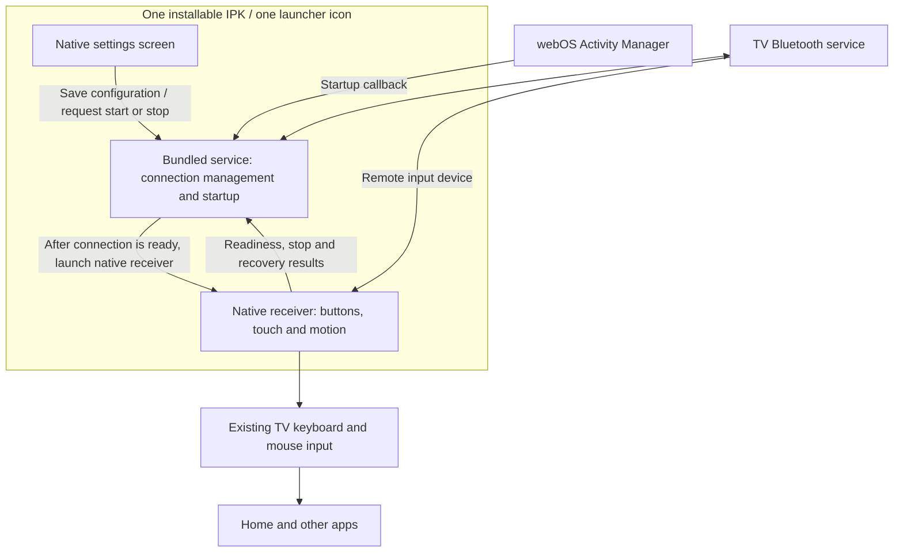

# Native app

The single-app version is being developed as a **native webOS application**, with a service inside the same IPK. The native setup preview is available below. It is not yet a replacement for the working three-package input runtime.

## Try the setup preview

[Download the native setup preview](../releases/native-preview/org.magicsirimote.app_0.1.0_arm.ipk) and [its SHA-256 checksum](../releases/native-preview/SHA256SUMS).

This package contains a native settings screen, a remote-friendly character picker, settings validation and a non-mutating input-access check. It contains **no device addresses or serial numbers**. Saving settings changes only this app's saved configuration. It does not pair a remote, program infrared, start remote control or register automatic startup.

The preview requires the same tested G3 environment, including the TV's 32-bit Python 3.10+ interpreter, SDL2 and SDL_ttf. It uses a font already installed on the TV. These dependencies are not bundled. Other TV models remain unverified.

1. Set up Developer Mode and the computer-to-TV connection using [the existing guide](../README.md#step-1-set-up-developer-access).
2. Install the IPK, replacing `my-tv` with the device name registered in your LG CLI:

   ```sh
   ares-install -d my-tv releases/native-preview/org.magicsirimote.app_0.1.0_arm.ipk
   ares-launch -d my-tv org.magicsirimote.app
   ```

3. Use the original LG remote's arrows and OK button to select a field. Choose characters on the screen; a USB keyboard can also enter text. **Back** leaves the character picker, and **Save settings** saves the completed form.
4. Select **Check this TV**. The check briefly opens the existing `LGE RCU` and `ClickableMouse` nodes and closes them without reading or writing events. Passing this check establishes native input access; it does not establish Bluetooth pairing or prove the complete remote-control runtime works.
5. Select **Close** to return to the TV. The preview does not run a background input program.

To remove only this preview:

```sh
ares-install -d my-tv -r org.magicsirimote.app
```

The existing controller, receiver and startup packages are separate and remain unchanged. Developer Mode expiry is managed separately using your usual tools.

## Settings

Only these device identities are entered manually in the preview:

| Field | What to enter |
| --- | --- |
| Remote Bluetooth address | The Siri Remote's Bluetooth address, such as `AA:BB:CC:DD:EE:FF`; not the TV's Wi-Fi or Ethernet address |
| Remote device name / serial | The exact name reported for the remote's HID identity; preserve upper/lower case |
| TV Bluetooth address | The TV's Bluetooth adapter address |

Entering these values **does not create a pairing**. A pairing/setup workflow still has to be integrated. The app's account identifiers and input-device paths are implementation details to discover on the TV, not information users should have to guess. The setup preview does not accept LG account credentials or Developer Mode tokens.

The intended complete app will also provide Start/Stop controls, automatic-startup provisioning and a separate, explicit infrared backup/programming operation. Those controls are not included in this preview.

## Intended single-package design



One app does not require one process. The service can manage a connection while the native receiver handles input. The native receiver needs to be launched after the remote's input device is available: the native environment exposes some device nodes when the app starts. Creating a child inside an older environment is not a substitute for obtaining a fresh native launch.

A JavaScript service is not a Web app. JavaScript is used for the service plumbing; the visible application and the input-capable process use the native app environment.

## What has been verified

On the tested G3, an isolated single-IPK probe demonstrated all of the following without starting another remote-input session:

- A bundled service can retrieve Bluetooth HID and GATT connection status.
- That service can launch the native application from the same package.
- The native process can verify the live service-side helper's process identity and read its request from their shared service directory.
- The native process can open the TV's `LGE RCU` and `ClickableMouse` input devices and return a result to the service.
- Both processes run under non-root accounts with no effective Linux capabilities.
- The TV's SDL2 and SDL_ttf libraries can render a native screen and close it normally.

The service itself cannot see `/dev/input` or the application directory, so placing the receiver directly inside a normal service does not work. The native process can see the bundled service directory. The proposed layout uses that shared location for the two roles' code and handoff state, preserving process and file verification.

**Still to integrate and verify:** the real controller/receiver handoff, sensor shutdown and crash recovery, opening settings while input is active, startup after full boot, standby/resume, first pairing and IR backup/programming. The preview must not be presented as a completed one-app remote-control release.

## Build from source

From the repository root, with Python and ARM-capable Clang installed:

```sh
python3 src/build_native.py --out build/native-preview
python3 -m unittest discover -s tests -p 'test_native_*.py'
```

The build writes one generic IPK, `SHA256SUMS` and a manifest describing the preview's limited purpose. It never contacts a TV. No per-TV configuration is required to build it. The existing `src/build.py` continues to build the separate controller/receiver/startup packages.

Source files are in [`src/native`](../src/native). Installed settings belong to the app's `state` directory; do not include that directory in a public bug report.

References: [webOS Homebrew native development](https://www.webosbrew.org/pages/native-development.html) describes native applications and the available graphics libraries; [LG's app/service template guide](https://webostv.developer.lge.com/develop/getting-started/app-template) describes packaging an app with services. Neither reference guarantees the measured permissions on other firmware.
