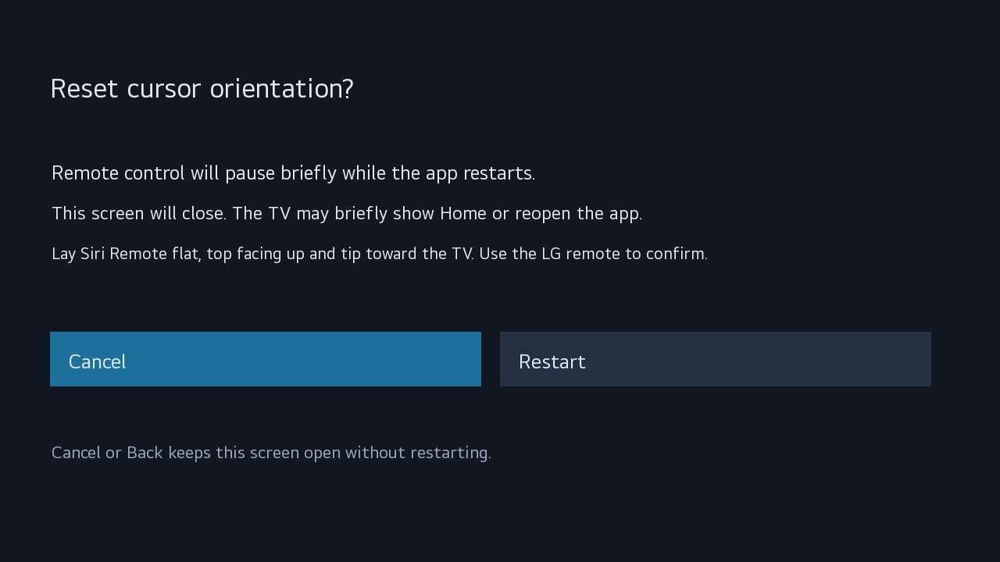

# Troubleshooting

## Keep Developer Mode active

Periodically open **Developer Mode** on the TV and check **Remain Session**. While time remains and the TV is online, use **EXTEND** to renew it. Magic Sirimote does not renew it for you. If Developer Mode becomes disabled, LG removes the apps installed through it. See [LG's session instructions](https://webostv.developer.lge.com/develop/getting-started/developer-mode-app#extending-developer-mode-time).

## The Mac cannot connect to the TV

Confirm that the TV is on, Dev Mode Status is on, and both devices are on the same local network. Run `sh install.sh` again and enter the current IP address shown by the TV; a previously saved address may have changed.

If key authentication fails, turn Key Server on and let the installer retrieve the key with the current on-screen passphrase. Do not switch Developer Mode off and on merely to refresh an IP address or key.

## The app does not open

Open Magic Sirimote from the TV's Home screen. If installation reported an error, rerun `sh install.sh` and follow its message before retrying.

## Pairing problems

- Start searching in the app **before** holding MENU + Volume Up. Release both buttons after about five seconds and keep the remote near the TV.
- Charge the remote if necessary, then disconnect its cable before testing input.
- If no candidate appears, choose **Search again** when offered and repeat the sequence.
- Pairing starts automatically when a supported, available remote is found. Put only your intended remote into pairing mode; wait for identity verification to finish. If the search expires, choose **Search again**.
- If remote identification fails, record the exact message. A name resembling “Siri Remote” is not sufficient for acceptance.

The pairing used by Magic Sirimote may not appear in the TV's ordinary Bluetooth-controller list. An empty list there does not by itself mean pairing failed. Use Magic Sirimote's own screen and test input instead.

## The remote does not respond after being idle

Siri Remote can go to sleep after a period of inactivity. **Press the touch surface down once to wake it**, then swipe or move the remote. Simply touching or swiping the surface may not wake it. Allow a moment for Bluetooth to reconnect. If it still does not respond, follow the checks below.

## Restart Siri Remote

If the remote remains unresponsive, restart the remote itself:

1. Disconnect its charging or diagnostic cable.
2. Press and hold **TV / Control Center** (the TV-picture button) and **Volume Down (−)** together for about **five seconds**.
3. Release both buttons and wait **5–10 seconds**.
4. Press the touch surface once, allow Bluetooth to reconnect, and try swiping again.

This is the remote-restart button sequence documented by [Apple](https://support.apple.com/en-us/102569). Apple TV status-light and connection messages in that guide do not apply to an LG TV. This is separate from Magic Sirimote's destructive **Reset app** command; do not choose Reset app just to restart the remote.

## Only power or volume works

Infrared and Bluetooth operate independently. Working IR buttons do not confirm that Bluetooth reception is working.

1. Press the touch surface once, then try a few swipes. Allow time for reconnection, especially just after turning on the TV.
2. With the LG remote, open Magic Sirimote and read any message. If a settings window was left open, choose **Close**, then try Siri Remote again.
3. Check that Developer Mode is still enabled.
4. If input remains unavailable, try a normal TV power-off/power-on with the LG remote, then press Siri Remote's touch surface once to wake it.
5. If normal power cycling does not help, a full restart may clear a stuck Bluetooth state: when the TV is not updating, turn it off, unplug it for about 30 seconds, reconnect power, and turn it on. Allow startup time before testing again.

Recovery is not guaranteed for every Bluetooth failure. If the problem keeps returning, report it rather than repeatedly resetting pairings or deleting app files. Include whether swipes, surface clicks, cursor movement and IR still work, and whether the problem followed sleep, power-on or saving settings.

## Bluetooth connects, but input remains unavailable

After repeated reconnections, LG's input manager can retain old input-device references until Siri Remote receives a device number that the app cannot access. Run the [installer](../README.md#3-run-the-installer) and choose the TV-side fix when offered. Updating the app IPK alone does not apply it.

Without root access, a full TV restart is a temporary recovery option: when the TV is not updating, turn it off, unplug it for about 30 seconds, reconnect power, and turn it on. This does not prevent recurrence. **Reset app is not needed for this recovery.**

## Swipes work but the pointer does not

Check that Gyro cursor is on and saved. Lift your finger completely off the touch surface. After a swipe, the pointer returns when you shake the remote from side to side, turning around twice within about half a second; it then appears at the center of the screen. Shaking mostly up and down does nothing. If movement is misdirected, lay the remote flat with its touch surface up and front end toward the TV. Choose **Reset cursor orientation**, confirm **Restart**, and leave the remote still until reception resumes. A working swipe does not necessarily mean orientation setup has completed yet.

Cursor orientation reset confirmation

## Voice input

Voice input is not supported.
